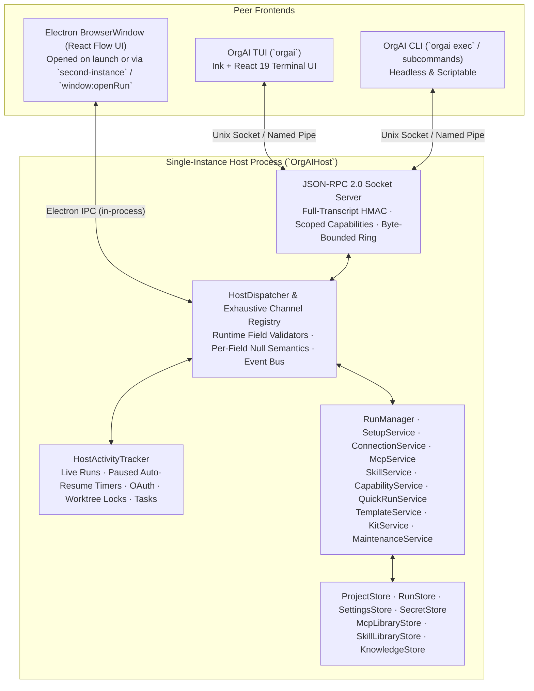

# OrgAI CLI & Local Daemon (`orgai`): Design and Architecture Specification

Status: **Revision 4 (Final Sign-Off)** — Refined after three rounds of architectural, security, and codebase reviews by **GPT Astra (`gpt-6-astra`)** and **Claude Opus (`claude-opus-4-6`)**.
Related: `.orgai/ARCHITECTURE.md`, `CLAUDE.md`, `docs/design/spec.md`, `docs/design/providers-and-mcp.md`, `docs/design/quick-runs.md`, `docs/design/knowledge.md`.

---

## 1. Executive Summary & Product Vision

**OrgAI CLI (`orgai`)** brings the full capabilities of OrgAI—a provider-agnostic harness that runs a project's **org chart of AI agents** with git worktree isolation, unattended plan execution, AI-driven setup, MCP/skill management, and engagement knowledge graphs—into the terminal.

It combines three proven workflows while preserving every runtime and security invariant in the codebase:

1. **Claude Code (`claude`) & Codex CLI (`codex`) terminal ergonomics**:
   - **Directory-first launch**: Running `orgai` inside a repository attaches to that folder's OrgAI project (or offers fast onboarding in interactive mode).
   - **Interactive Terminal UI (TUI)** for live multi-agent orchestration, hierarchical agent tree inspection, slash commands, and keyboard-driven decision cards.
   - **Scriptable headless execution (`orgai exec` / `orgai -p`)** with deterministic exit codes, narrowing-safe per-run overrides (`RunOverrides`), adapter-quiescent completion rules, and schema-versioned JSON/JSONL (`--output-format text|json|stream-json`) output for CI and automation.
2. **OpenCode (`opencode` + `opencode desktop`) & `codex app-server` single-host architecture**:
   - **One authoritative single-instance host (`OrgAIHost`) per `dataDir`**: The Desktop window and the CLI/TUI are peer frontends connected to the same single-instance host process. When started by the CLI (`orgai`), the OrgAI host boots in windowless background mode (`--headless-host`); if the user later opens the Desktop app (or runs `orgai app`), Electron's `second-instance` handler opens the `BrowserWindow` inside that **same** host process—eliminating process handoffs, proxy relays, and `safeStorage` incompatibilities.
   - **Pure-Node In-Process Mode (`--host inproc`)**: For headless CI runners and container environments without Electron, `OrgAIHost` also boots directly in plain Node >= 22 with an ephemeral in-memory secret overlay (`OverlaySecretStore`).
3. **OrgAI's multi-agent harness differentiators**:
   - Enforces a project's **Org Chart** (`spawnable` hierarchy, role prompts, tool/MCP/skill grants, model tiers `top | deep | everyday | fast`, depth and concurrency caps).
   - Isolates writing subagents in **nested git worktrees** (`WorktreeIntegrator`) with reentrant, cross-process repo-locked merges (`withRepoLock`), merge review cards, conflict handoff, and `orgai worktrees` maintenance.
   - Drives **unattended multi-turn plans** (`ContinuationDriver`), tracks **5h / 7d subscription windows** (with pause/auto-resume and everyday-tier steering), and supports both **Code Projects** (`.orgai/ARCHITECTURE.md`) and **Consulting Engagements** (`ENGAGEMENT.md`, Context Notes, and the Engagement Knowledge Graph).

---

## 2. Design Principles & Non-Negotiable Invariants

1. **Single-owner runtime host with atomic pre-store locking.** At most one `OrgAIHost` instance owns a `userDataDir` (`dataDir = <userDataDir>/data`) at any moment. Exclusive ownership acquisition (`app.requestSingleInstanceLock()` after `userData` override + atomic `<dataDir>/run/startup.mkdir` mutex + bound per-instance kernel socket `d-<hostInstanceId>.sock` / Named Pipe + `<dataDir>/run/daemon.json`) occurs **before** any store constructor (`RunStore`, `ProjectStore`, `SettingsStore`, `SecretStore`) or boot housekeeping runs, preventing concurrent boot normalization from marking live runs `finished` (`endedBy: 'app'`).
2. **Honest same-user threat model & defence-in-depth self-control gate.** On Unix/Windows without mandatory access control, unsandboxed code running as the user's UID (such as approved build scripts, MCP stdio servers, or commands that Codex executes inside its own `workspace-write` sandbox without consulting `onCommandApproval`) shares the user's filesystem privileges. Accordingly:
   - Every host always binds its per-instance socket and writes `daemon.json` to enforce single-instance ownership, while **external CLI/TUI RPC access** is gated by `AppSettings.terminalServer` (turned on in App settings or by installing the `orgai` command; a host that `orgai` launches headless or in process accepts terminal clients for that session only and never saves it; when disabled, `host.hello` refuses external clients with `code: 'terminal_server_disabled'`). What a client may do is capped by `AppSettings.terminalAccessLevel` (`'operate'` by default: `read` + `operate`; `'full'` adds `decide` + `configure`), which only the desktop window raises; see 3.3 (Review fixes, PR #18).
   - A built-in pre-mode denial check **`checkSelfControlDenial`** (invoked **before** `matchingRule`, `permissionMode` checks, auto-classifiers, or permission cards in `claude.ts`, `codex.ts`, and `mock.ts`) denies agent tool calls (`Bash`, `PowerShell`, `Read`, `Glob`, `Grep`, `Edit`, `Write`, `MultiEdit`, `NotebookEdit`) that invoke `orgai` or read/write `<dataDir>/run/**`, `<dataDir>/secrets.json`, `<dataDir>/codex/**`, or the runtime socket directory—while keeping `<dataDir>/quick/quick_<id>`, `<dataDir>/project-skills/`, and `<dataDir>/skills/` accessible to runs that use them.
   - Socket connections authenticate the full handshake transcript (binding all client and host fields via JSON-array HMAC-SHA256). Capability scopes (`'read'`, `'operate'`, `'decide'`, `'configure'`) act as a least-privilege guardrail for CLI subcommands (where `'operate'` `RunOverrides` can only **narrow** permissions/autonomy via an explicit transition matrix, never widen them without `'configure'`).
3. **Zero duplicated runtime or view-model logic.** Adapters (`claude.ts`, `codex.ts`, `mock.ts`), `RunManager`, `harnessTools.ts`, `prompts.ts`, `continuation.ts`, `integration.ts`, `worktrees.ts`, `permissionRules.ts`, `ruleMatch.ts`, `pricing.ts`, `runUsage.ts`, and all stores are shared 100%. Pure renderer view-models (`runStatus.ts`, `runChains.ts`, `viewPendingCards.ts`, `needsYou.ts`, `orgDiff.ts`, `mcpProposal.ts`, `transcriptRows.ts`, `usageView.ts`, `cost.ts`, `teamView.ts`, `permissionCopy.ts`) move to `src/shared/view/` (with re-exports in `src/renderer/src/lib/`) so both `tsconfig.node.json` and `tsconfig.web.json` compile them.
4. **Exact contract & vocabulary parity.** Every CLI and TUI surface uses the exact channel names in `src/shared/types.ts`, the exact status words from `statusText` (`Running`, `Needs you`, `Idle`, `Paused`, `Finished`, `Stopped`, `Ended when OrgAI closed`, `Failed`), `agentLabel`, and `permissionOffer`.
5. **Terminal output is an untrusted-data boundary.** Every human-readable string originating from a model, agent handle, filename, diff, error message, MCP registry entry, or knowledge graph item passes through a per-stream stateful streaming TTY sanitizer (`sanitizeTty`) before terminal rendering, preventing OSC 52 clipboard injection, OSC 8 link spoofing, CSI screen redraws, and bidi spoofing.
6. **Token-free testability.** Every CLI command, daemon handshake, and TUI flow is verifiable under `ORGAI_MOCK=1` and an isolated `ORGAI_DATA_DIR` without spending tokens.

---

## 3. System Architecture: `OrgAIHost`, Single-Instance Daemon & Transports

### 3.1 Module Dependency Graph & Electron Decoupling

Today in `src/main/`, five files import `electron` directly (`index.ts`, `ipc.ts`, `log.ts`, `notifications.ts`, `appMenu.ts`), and `log.ts` is imported transitively by `RunManager` and `McpService`.

To allow `OrgAIHost` to boot cleanly in both Electron (Desktop / `--headless-host`) and pure Node (`--host inproc` for CI/tests):
1. **`src/main/log.ts`** removes its top-level `import { app } from 'electron'`. `installLogging(env: HostRuntimeEnv)` receives `{ userDataDir, logsDir, appVersion, isPackaged, electronVersion }` from the entry point (`src/main/index.ts` or `src/cli/inprocHost.ts`). A unit test (`src/main/host/noElectronImport.test.ts`) verifies that importing `bootOrgAIHost` in plain Node loads zero `electron` modules.
2. **Pure view-models move to `src/shared/view/`**: `runStatus.ts`, `runChains.ts`, `viewPendingCards.ts` (from `src/renderer/src/lib/pendingCards.ts`), `needsYou.ts`, `orgDiff.ts`, `mcpProposal.ts`, `transcriptRows.ts`, `usageView.ts`, `cost.ts`, `teamView.ts`, and `permissionCopy.ts` move to `src/shared/view/` with re-exports in `src/renderer/src/lib/`.



---

### 3.2 Single-Owner Lock, Unified Host Lifecycle & Crash Recovery

#### 1. Unified Electron Host (`--headless-host` + `second-instance` / `activate`) & Pure-Node `--host inproc`
Rather than running two competing host binaries (a Node daemon vs. an Electron Desktop app) that would fight over `safeStorage` and live child processes:
- **`userDataDir` vs `dataDir` Convention**:
  - Following `src/main/log.ts:31-36` and `src/main/index.ts:250`, `--data-dir <dir>` and `ORGAI_DATA_DIR` specify the **application `userDataDir`** (resolved to an absolute canonical path by the CLI before spawning any host so relative paths are never interpreted against the host's cwd), and `dataDir` is always `join(userDataDir, 'data')`.
- **Standard Host (`--host auto|daemon`)**: The host is the single-instance OrgAI application process:
  - **Electron Entry Ordering**: Resolve and set `app.setPath('userData', canonicalPath(userDataDir))` -> install `app.on('second-instance', ...)` and `app.on('activate', ...)` -> call `app.requestSingleInstanceLock({ headless: isHeadlessHost })`. If `requestSingleInstanceLock` returns `false`, the losing process exits `0` immediately **without** touching `<dataDir>/run/`, `startup.mkdir`, `daemon.json`, or `daemon.secret`.
  - When started by clicking the Desktop app icon, it boots `OrgAIHost` and opens the main `BrowserWindow`.
  - When started by the CLI (`orgai` or `orgai daemon start`) while Desktop is not running, the CLI spawns the OrgAI app binary with `--headless-host` (on macOS, `app.dock?.hide()`; no `BrowserWindow` is created).
  - **`second-instance` & `activate` Handling**:
    - When `app.on('second-instance', (_event, argv) => ...)` fires in the incumbent host: if `argv` includes `--headless-host` (e.g. a concurrent CLI spawn raced a running Desktop app), the incumbent does **not** open or focus a `BrowserWindow` (it simply ensures the socket server is ready); otherwise, it shows the Dock icon (`app.dock?.show()`), opens/focuses the `BrowserWindow` (focusing `--run <id>` if passed), and attaches to the **already-running `RunManager` and stores**.
    - On macOS, clicking the Dock icon or relaunching from Finder fires `app.on('activate')`, which shows the Dock icon and creates the main `BrowserWindow` when `BrowserWindow.getAllWindows().length === 0`.
  - **Window Close vs Explicit Quit**:
    - On `window-all-closed` (review H3, PR #18): a host launched with `--headless-host` clears `windowScopes`, hides the Dock icon on macOS and stays in the background until its idle exit, while no run is working. With runs working it is treated like a desktop launch (review follow-up: an `orgai` command may have spawned it and the user then opened OrgAI from the Start menu, whose window lives in that host): macOS stays, Windows and Linux ask. A desktop launch on macOS stays (Dock behaviour). A desktop launch on Windows and Linux quits through `quitGate` (stopping its runs), as before the host work; only while runs are working without the user (`RunManager.workingRunCount`: not idle runs, runs with an open card, runs held by an interrupt or a usage limit, or paused runs waiting for an auto-resume) it first asks "Keep working in the background / Stop and quit / Cancel" (Cancel brings a window back). It never goes to the background without that answer.
    - On explicit application Quit (`Cmd+Q` / File > Quit) while CLI-started runs or TUI clients are active, `quitGate` (`src/main/index.ts:569-579`; replaced in Wave 7 by the `ShutdownCoordinator`, see Wave 7 below) offers `"Keep background host running for N terminal run(s)"` alongside `"Stop all runs and quit"`.
- **Pure-Node In-Process Host (`--host inproc`)**:
  - Boots `OrgAIHost` directly inside the Node >= 22 CLI process without Electron, sharing the exact universal `<dataDir>/run/` ownership protocol below (refusing with exit code `6` if an Electron or Node host already owns `dataDir`), binding its per-instance socket so `orgai watch` / `orgai decide` can attach, and using `OverlaySecretStore` for environment-supplied secrets.

#### 2. Universal Pre-Store Ownership & Recovery State Machine (`<dataDir>/run/`)
Node's standard library does not expose `flock()`/`fcntl()`, and `RunStore`'s constructor (`src/main/store/runs.ts:48-79`) rewrites non-terminal runs on instantiation. Furthermore, `SettingsStore` is constructed *after* Step 0, so every host **always** binds its per-instance socket and writes `<dataDir>/run/daemon.json` to establish ownership (while `AppSettings.terminalServer` gates whether external `cli`/`tui` `host.hello` handshakes are accepted once ready).

**Step 0 of `bootOrgAIHost`** runs before any store constructor or housekeeping sweep:

1. **Ensure `<dataDir>/run` Exists (`0700`)**: Verified via `lstatSync` as a real directory owned by `process.getuid()` on POSIX.
2. **Acquire Short-Lived Startup Mutex (`<dataDir>/run/startup.mkdir`)**:
   - Call `mkdirSync(startupDir, { mode: 0o700 })`. Immediately write `<dataDir>/run/startup.mkdir/owner.json.tmp` (`{ pid, processStartTime, hostInstanceId, createdAt }`) and `renameSync` to `owner.json`.
   - If `mkdirSync` throws `EEXIST`:
     - Read `<dataDir>/run/startup.mkdir/owner.json`.
     - If `owner.json` is not yet present (writer still between `mkdir` and `rename`) and `statSync(startupDir).mtimeMs` is `< 2,000 ms` old, treat it as young and retry every `100 ms`.
     - Check `isLiveProcess(owner.pid, owner.processStartTime)` (`process.kill(pid, 0)` succeeds or throws `EPERM`, and the OS process start timestamp matches `owner.processStartTime` to defeat PID reuse). If the owner process is **alive**, **never steal** regardless of elapsed time: poll until `startup.mkdir` is released (up to `30,000 ms`, then abort with `HostStartingOrBusyError`, exit code `6`).
     - Only if the owner process is provably dead (`ESRCH` or `processStartTime` mismatch) — or `owner.json` is still missing/corrupt after `2,000 ms` — reclaim the stale directory by **atomically renaming** it (`renameSync(startupDir, `${startupDir}.stale-${randomUUID()}`)`) and removing the renamed directory. (If `renameSync` fails with `ENOENT`, another contender won the rename; loop and retry.)
3. **Probe Incumbent `daemon.json`, Bind Per-Instance Socket & Publish `state: 'starting'` (Held for Milliseconds)**:
   - While holding `startup.mkdir`, if `<dataDir>/run/daemon.json` exists, check `isLiveProcess(daemon.pid, daemon.processStartTime)` and attempt a `1,500 ms` connection to `daemon.endpoint`:
     - If the socket connects, fails with `EACCES`, or times out (`ETIMEDOUT`) while `isLiveProcess` is `true`, a live host owns `dataDir`: remove our `startup.mkdir` and abort boot with `HostAlreadyRunningError` (exit code `6`).
     - Only when the socket returns `ENOENT` or `ECONNREFUSED` **and** `isLiveProcess` is `false`, unlink the dead instance's specific socket path `daemon.endpoint` (if it lies inside `<dataDir>/run/` or a `tmpdir/orgai-*` runtime dir) and sweep any orphaned `orgai-*` runtime directories whose owner PID is dead.
   - Generate a fresh 32-byte hex secret in `<dataDir>/run/daemon.secret` (`mode: 0o600`; on Windows, if `userDataDir` is outside `%APPDATA%` / `%LOCALAPPDATA%`, apply an explicit current-user-only DACL via `icacls`; ownership restricts the run folder and the secret to the user's SID before any listener is bound, `protocol.ts` `restrictDaemonSecretAcl` through `protectSecretOnWindows`, and the socket server refuses every hello while ownership reports the secret unprotected).
   - Bind a **unique per-instance listener** so no host ever unlinks another host's socket path:
     - **macOS / Linux**: `<dataDir>/run/d-<hostInstanceId>.sock` (`mode: 0o600`, where `hostInstanceId` is a 12-hex-char random ID). If `Buffer.byteLength(sockPath) >= 100` (leaving headroom under macOS's 104-byte and Linux's 108-byte `sun_path` limits), create `<runtimeBase>/orgai-<hostInstanceId>` (`mode: 0o700`, verified via `lstatSync`) under `$XDG_RUNTIME_DIR` or `os.tmpdir()` and bind `d.sock` inside it.
     - **Windows**: Named Pipe `\\.\pipe\orgai-<sha256(canonicalPath(dataDir)).slice(0, 20)>-<hostInstanceId>`. (Because each host instance uses a unique pipe suffix to prevent cross-user pipe squatting, single-instance exclusivity on Windows is enforced by the `startup.mkdir` + `daemon.json` liveness protocol above.)
   - Atomically write `<dataDir>/run/daemon.json` with `state: 'starting'` (`{ hostInstanceId, pid, processStartTime, endpoint, state: 'starting', startedAt }`) via `.tmp` + `renameSync`, and **immediately remove `startup.mkdir`**.
4. **Store Construction, Boot Sweeps & Transition to `state: 'ready'`**:
   - While `state === 'starting'`, the bound socket accepts connections and replies to `host.hello` with `{ error: { code: 'host_starting', retryAfterMs: 250 } }`.
   - Construct stores (`ProjectStore`, `SettingsStore`, `RunStore`, `SecretStore`, `McpLibraryStore`, `SkillLibraryStore`, `knowledgeStore`), kick off background provider/model probes (`src/main/index.ts:508,540`), and run boot housekeeping in the exact order of `src/main/index.ts:545-552`: `orphanRunProjects` -> `runs.prune` -> `worktrees.sweepOrphans` -> `sweepScratchDirs` -> `sweepStaleSkillDirs`.
   - Atomically update `<dataDir>/run/daemon.json` to `state: 'ready'`.

#### 3. Hostless Read-Only Commands (`ReadOnlyStoreReader`)
- Read-only CLI commands (`orgai status`, `orgai runs list`, `orgai runs show`, `orgai inbox`) first attempt to connect to `<dataDir>/run/daemon.json` (never touching `startup.mkdir`).
- If `daemon.json` has `state: 'starting'` (or `startup.mkdir` exists with a live owner PID), the reader polls for up to `2,000 ms`. If the host is still in `state: 'starting'` after `2,000 ms` with a live PID, `ReadOnlyStoreReader` reads `projects.json` and `runs.json` into memory with `hostState: 'starting', liveInboxAvailable: false` **without** marking active runs as crashed.
- Only when no live host owns `dataDir` does `ReadOnlyStoreReader` normalize non-terminal runs (`starting | running | idle | paused | stopping`) **in memory** with `status: 'finished'`, `endedBy: 'app'`, `endedWithApp: true`, reporting `hostState: 'stopped', liveInboxAvailable: false` (never writing to disk or fabricating pending cards).

#### 4. Unified Activity Tracking & Ownership-Safe Drain (`HostActivityTracker`)
Used identically for idle daemon exit, `orgai daemon stop`, and Desktop window close:
- **Tracked Leases**:
  1. `liveRuns`: `runManager.busyRunCount()` (review H3): live runs working without the user or stopping, plus exec runs not yet finalized. A run that only waits on its user (idle, a card open, held by an interrupt or a usage limit; `src/main/runtime/runActivity.ts`) does not count, so a background host's idle exit ends it like a quit (continuable).
  2. `pausedAutoResumes`: count of active `resumeTimers` in `RunManager` (`runManager.hasActiveResumeTimers()`). When an `autoResume` timer fires (`runManager.ts:2541`), `RunManager` acquires an `inFlightStarts` lease **before** deleting the timer entry and holds it across async `setup.prepare` until `continueRun` registers the successor in `activeRuns` (eliminating any lease-transfer gap). *(Note: a paused 5h/7d rate-limited run with `autoResume` enabled keeps the background host alive until its reset timer fires or `runs:cancelAutoResume` / `orgai daemon stop --force` is called.)*
  3. `inFlightRpcMutations`: count of executing `'operate'`, `'decide'`, or `'configure'` RPC calls.
  4. `activeWorktreeOps`: count of both queued waiters and active holders inside `withRepoLock`.
  5. `backgroundTasks`: in-flight `generateRunTitle`, `CapabilityService` (`discover` / `recommend` / `review`), and `SkillEvaluationService` runs.
  6. `activeOAuthFlows`: active loopback OAuth servers on `127.0.0.1:38917` or device-code login flows.
  7. `interactiveClients`: open `BrowserWindow`s or attached TUI sockets.
- **Ownership-Safe Drain Transition**:
  - When idle timeout (`ORGAI_DAEMON_IDLE_MINUTES`, default 30 min) or `orgai daemon stop` triggers and all leases are zero, the host sets `state = 'draining'` (rejecting new incoming connections/mutations with `code: 'host_draining'`).
  - To shut down without racing a newly starting host, the departing host acquires `startup.mkdir` (or verifies `daemon.json`), unlinks `<dataDir>/run/daemon.json` **only if its `hostInstanceId === self.hostInstanceId`**, closes and unlinks its own `d-<hostInstanceId>.sock`, releases `startup.mkdir`, and exits cleanly.

#### 5. Single-Order Reentrant Cross-Process Repository Lock (`withRepoLock` in `src/main/runtime/worktrees.ts`)
Today `withRepoLock(checkoutPath, fn)` (`worktrees.ts:63-90`) checks reentrancy via `heldLocks` (`AsyncLocalStorage<Set<string>>`) and queues per checkout, while `integrateWorktree(root)` holds `withRepoLock(root)` and calls `commitLeftovers(wt)` (`:303,308` -> `:243`), which calls `withRepoLock(wt)`.
In a multi-agent or multi-surface environment, taking a per-checkout queue *before* a per-repository (`commonGitDir`) queue creates an ABBA lock-order deadlock (e.g., Task B in `integrateWorktree(root)` holds `checkout(root)` + `commonDir` and calls `commitLeftovers(wt)` waiting on `checkout(wt)`, while Task C in `commitLeftovers(wt)` holds `checkout(wt)` and waits on `commonDir`).

To eliminate both cross-process git corruption and ABBA deadlocks:
1. **Single Global Lock Granularity Keyed by `commonGitDir`**:
   - `commonGitDir(checkoutPath)` resolves the repository's canonical common git directory via `git rev-parse --path-format=absolute --git-common-dir` (falling back to `resolve(checkoutPath, gitCommonDir)`) and `canonicalPath()`.
   - Update both `prepareRepo` (`worktrees.ts:93-109`) and `removeExcludeLine` (`worktrees.ts:112-119`) to resolve `git rev-parse --git-path info/exclude` so linked worktrees and `.git`-file checkouts work reliably.
   - Update `worktrees.ts:71-72`, `.orgai/ARCHITECTURE.md`, and `CLAUDE.md` to document that `withRepoLock` serializes all git operations per repository (`commonGitDir`).
2. **Strict Lock Acquisition Order & Scoped Lease Tokens (`RepoLockLease`)**:
   - Replace `heldLocks: AsyncLocalStorage<Set<string>>` with `heldLocks: AsyncLocalStorage<Map<string, RepoLockLease>>`, where `interface RepoLockLease { commonDir: string; released: boolean }`.
   - When `withRepoLock(checkoutPath, fn)` is called:
     1. **Step 1 — Reentrancy Check First (Before Any Queue)**:
        Look up `const existing = heldLocks.getStore()?.get(commonDir)`. If `existing && !existing.released`, the current async call chain already holds the repository lock (covering both same-checkout nesting like `integrateWorktree(root)` -> `discardWorktree(root)` at `:317,:333` and cross-checkout nesting like `integrateWorktree(root)` -> `commitLeftovers(wt)` at `:308`). Execute `await fn()` directly! *(Because `existing.released` is set to `true` when the outer `withRepoLock` exits, any detached fire-and-forget async work spawned inside a locked scope cannot accidentally bypass locking after the outer scope finishes.)*
     2. **Step 2 — In-Process `commonDir` Queue & Cross-Process `<commonDir>/orgai-repo.lock`**:
        Increment `activeWorktreeOps` (counting waiters + holder). Enter the in-process promise queue `repoLocks.get(commonDir)`. Once at the head of the queue, acquire the directory mutex `<commonDir>/orgai-repo.lock` via `mkdir` + atomic `owner.json` (`{ pid, processStartTime, hostInstanceId, acquiredAt }`), refreshing `owner.json` mtime every `2,000 ms` while held and bounding wait at `60,000 ms` with a clear `RepoLockTimeoutError`.
     3. **Step 3 — Scoped Execution & Release**:
        Create `const lease: RepoLockLease = { commonDir, released: false }` and execute `fn()` inside `heldLocks.run(new Map([...current, [commonDir, lease]]), fn)`. In `finally`, set `lease.released = true`, remove `<commonDir>/orgai-repo.lock`, advance the `commonDir` queue, and decrement `activeWorktreeOps`.
3. **Lock Hierarchy with `WorktreeIntegrator.exclusive()` & Human Merge Reviews**:
   - `WorktreeIntegrator.exclusive()` (`integration.ts:81-91`) is always acquired outer-first before calling `worktrees.ts`. Inside `worktrees.ts:301-344`, `integrateWorktree` releases `withRepoLock` before returning `{ status: 'conflict' }`, so the cross-process `<commonDir>/orgai-repo.lock` is **never** held while `integration.ts:192` awaits human input on `ctx.requestMergeReview`, and is re-acquired only when `decideMerge` executes.
4. **Crash Recovery Inspection (Including Linked Worktree Index Locks)**:
   - If `<commonDir>/orgai-repo.lock` exists and `isLiveProcess(owner.pid, owner.processStartTime)` is `false`, reclaim it via atomic `rename` to `.stale-<uuid>` + removal, log a warning, and inspect `<commonDir>/index.lock`, `<commonDir>/worktrees/<name>/index.lock`, and `MERGE_HEAD` in the target checkout; if dirty, leave the worktree branch intact and surface a recovery notice rather than running destructive git commands.

---

### 3.3 Wire Protocol: Authenticated JSON-RPC 2.0 over Local Socket

All frames are newline-delimited UTF-8 JSON (`\n`).

#### 1. Frame Limits, Bulk Memory Budget & Clearable-Field JSON Semantics (Derived from `src/shared/defaults.ts` & `src/shared/types.ts`)
- **Connection Quotas**: Max `16` concurrent unauthenticated sockets (2,000 ms handshake deadline each); max `32` concurrent authenticated client sockets; max `4` concurrent in-flight RPC requests per socket.
- **Pre-Authentication Frame Cap**: **16 KB** max line length until `host.hello` succeeds.
- **Post-Authentication Request & Response Caps**:
  - Standard control channels: **2 MB** request / **16 MB** response (`runs:subscribe`).
  - Bulk channels (derived from `MAX_IMAGE_BYTES * MAX_IMAGES_PER_MESSAGE` in `src/shared/defaults.ts:103,108,110` = 50 MB raw / ~67 MB base64, `KIT_MAX_BYTES` = 50 MB, `KNOWLEDGE_FILE_MAX_BYTES` = 64 MB): **80 MB** max request/response frame length for `runs:start`, `runs:startQuick`, `runs:continue`, `runs:send`, `runs:get` (since stored `RunRecord` transcripts can contain user base64 images), `kit:exportBundle`, `kit:previewBundle`, `kit:applyBundle`, `knowledge:get`, and `skillLibrary:addFromBundle`.
  - **Global Host Bulk-Frame Memory Budget**: A host-wide semaphore caps concurrent in-flight bulk frames (`> 2 MB`) across all connected sockets at **`256 MB`** total so concurrent clients cannot exhaust host heap.
- **Safe JSON Reviver & Per-Field Clearable/Nullable Codec (`src/main/host/registry.ts`)**:
  - All incoming JSON is parsed with a reviver that strips `__proto__`, `constructor`, and `prototype` properties.
  - Because `JSON.stringify` drops own properties with `undefined` values while `settings:set` (`src/main/ipc.ts:1416-1425`) and `projects:save` clear optional settings via an own `{ key: undefined }` property, `src/main/host/registry.ts` defines an explicit per-channel **nullable vs. clearable field table**:
    - **Domain-nullable fields** (`connections:setDefault(null)`, `connections:setSecret({ id, apiKey: null })`, `connectors:setToken({ ..., token: null })`, `SettingsProposalPayload.maxBudgetUsd: null`) preserve literal `null`.
    - **Clearable optional fields** (`Project.maxBudgetUsd`, `Project.defaultTier`, `Project.worktreeSetupCommand`, `Project.permissionMode`, `AppSettings.defaultProjectDir`, `Connection.baseUrl`) accept `null` over JSON-RPC and decode it into an own `{ key: undefined }` property before invoking the store handler.
  - A unit test (`src/main/host/jsonRoundTrip.test.ts`) verifies every `OrgAIApi` request, clear operation, and response survives JSON serialization.

#### 2. Full-Transcript Mutual HMAC Handshake

```ts
// Step 1: Host -> Client (sent immediately on socket connect)
export interface RpcChallengeFrame {
  jsonrpc: '2.0'
  method: 'host.challenge'
  params: {
    protocolVersion: 1
    hostInstanceId: string
    hostNonce: string // 32-byte hex random nonce
  }
}

// Step 2: Client -> Host
export interface RpcHelloRequest {
  jsonrpc: '2.0'
  id: 1
  method: 'host.hello'
  params: {
    protocolVersion: 1
    clientKind: 'tui' | 'cli'
    clientVersion: string
    pid: number
    cwd: string
    clientNonce: string // 32-byte hex random nonce
    requestedScopes: ('read' | 'operate' | 'decide' | 'configure')[]
    /**
     * Canonical structured full-transcript HMAC (binds all client fields including cwd):
     * HMAC-SHA256(daemon.secret,
     *   JSON.stringify(['client:v1', protocolVersion, hostInstanceId, hostNonce, clientNonce, clientKind, clientVersion, pid, cwd, requestedScopes]))
     */
    clientProof: string
  }
}

// Step 3: Host -> Client
export interface RpcHelloResult {
  protocolVersion: 1
  hostInstanceId: string
  hostKind: 'desktop' | 'headless-host' | 'inproc'
  appVersion: string
  dataDir: string
  mock: boolean
  grantedScopes: ('read' | 'operate' | 'decide' | 'configure')[]
  /** Populated when clientVersion !== appVersion; 'read', 'operate', and 'decide' still work when protocolVersion matches. */
  versionSkewWarning?: string
  /**
   * Canonical structured full-transcript HMAC (binds all host fields):
   * HMAC-SHA256(daemon.secret,
   *   JSON.stringify(['host:v1', protocolVersion, hostInstanceId, clientNonce, hostNonce, hostKind, appVersion, dataDir, mock, grantedScopes]))
   */
  hostProof: string
}
```

#### 3. Exhaustive 156-Channel Registry & Push Topics (`src/main/host/registry.ts`)
Every single channel constant across `IPC`, `TEMPLATE_ENGAGEMENT_IPC`, `KNOWLEDGE_IPC`, `MCP_SCOPE_IPC`, `KIT_IPC` and `TEAM_FILES_IPC` in `src/shared/types.ts` (all **156** unique existing channels: 146 request channels + 10 push channels), plus the 5 new `HOST_IPC` channels (`runs:subscribe`, `skillLibrary:addFromBundle`, `kit:exportBundle`, `kit:previewBundle`, `kit:applyBundle`) and the `host.*` protocol methods, must have an explicit entry in `HOST_CHANNEL_REGISTRY` (enforced by `registry.test.ts`; any unmapped channel is rejected with `code: 'unknown_channel'`). *Counts as implemented after the merge with dev on 2026-11-05: **177** existing channels (165 request + 12 push: 8 socket_subscribable, 4 desktop_only) plus 6 `HOST_IPC` channels (`runs:findDecision` added in Wave 3) and the 5 `host.*` methods; 24 request channels are desktop_only (the merge with dev on 2026-11-05 added `projects:folderConfig`, `projects:setFolderConfigTrust`, `permissions:ignored` and the 7 request + 1 push `TEAM_FILES_IPC` channels). The table below lists them all.* Push channels have `direction: 'push'` and are **never** RPC-invokable:

| Direction & Scope | Channels (`src/shared/types.ts` + `HOST_IPC` + `host.*`) |
| --- | --- |
| **`request: read`** | `host.status`, `host.subscribe`, `app:info`, `app:logPath`, `settings:get`, `auth:status`, `projects:list`, `projects:get`, `projects:checkPath`, `projects:previewRemap`, `projects:scanAgents`, `projects:previewImport`, `projects:removePreview`, `projects:engagementDocument`, `projects:listNotes`, `projects:getNote`, `runs:list`, `runs:get`, `runs:listLive`, `runs:pendingCards`, `runs:usageStats`, `runs:usageCsv`, `runs:usageOverview`, `runs:usageOverviewCsv` (app-wide usage, 2026-11-07), `runs:subscribe`, `permissions:list`, `permissions:ignored`, `connections:list`, `models:list`, `models:prices`, `mcp:list`, `mcp:registrySearch`, `mcpLibrary:list`, `connectors:list`, `connectorPresets:list`, `skills:list`, `skills:read`, `skills:previewImport`, `skills:lastEvaluation`, `skillLibrary:list`, `skillLibrary:read`, `capabilities:lastReview`, `maintenance:listWorktrees`, `maintenance:diff`, `templates:list`, `knowledge:get`, `knowledge:inferredLinks`, `kit:previewBundle`, `projects:folderConfig`, `teamFiles:listAttention`, `app:reference` (self-knowledge, 2026-11-07: the secret-free reference and status snapshot) |
| **`request: operate`** | `runs:start`, `runs:startQuick`, `runs:continue`, `runs:send`, `runs:interrupt`, `runs:stop`, `runs:resumeNow`, `runs:cancelAutoResume`, `setup:start`, `setup:retro`, `mcp:startAssist`, `skills:startAssist`, `usage:refresh`, `connections:test`, `models:refresh`, `mcp:test`, `mcpLibrary:test`, `capabilities:discover`, `capabilities:recommend`, `capabilities:cancel`, `capabilities:review`, `skills:evaluate`, `draft:orgChart`, `window:openRun` *(refused with `code: 'desktop_unavailable'` when running under `--host inproc`)* |
| **`request: decide`** | `runs:decide`, `permissions:decideRequest`, `setup:decide`, `setup:answer`, `merges:decide`, `mcp:answerInstall` *(Note: `'decide'` authorizes resolving an active run's pending cards—including run-raised project rule grants, library/project MCP installs, or setup proposals—whereas direct out-of-band store mutations require `'configure'`.)* |
| **`request: configure`** | `host.stop`, `settings:set`, `projects:create`, `projects:save`, `projects:remove`, `projects:remapModels`, `projects:applyImport`, `projects:exportOrg`, `projects:updateEngagementDocument`, `projects:saveNote`, `projects:removeNote`, `runs:promoteQuick`, `permissions:add`, `permissions:remove`, `connections:connect` *(enables disabled connections & remaps project models in `src/main/connections/service.ts:588`)*, `connections:update`, `connections:setSecret`, `connections:login`, `connections:cancelLogin`, `connections:logout`, `connections:setDefault`, `mcp:upsert`, `mcp:remove`, `mcp:setSecret`, `mcp:linkLibrary`, `mcp:promote`, `mcp:authorize`, `mcp:cancelAuthorize`, `mcp:revokeAuth`, `mcp:copyFromLibrary`, `mcp:setProjectOverrides`, `mcpLibrary:upsert`, `mcpLibrary:remove`, `mcpLibrary:setSecret`, `connectors:add`, `connectors:setToken`, `connectorPresets:upsert`, `connectorPresets:remove`, `plugins:upsert`, `plugins:remove`, `skills:create`, `skills:update`, `skills:remove`, `skills:linkLibrary`, `skills:promote`, `skills:applyImport`, `skills:undoImport`, `skills:applySuggestion`, `skillLibrary:create`, `skillLibrary:addFromBundle`, `skillLibrary:update`, `skillLibrary:remove`, `capabilities:apply`, `capabilities:undo`, `capabilities:dismiss`, `capabilities:restore`, `maintenance:integrateWorktree`, `maintenance:discardWorktree`, `maintenance:uninstallRepo`, `templates:saveFromProject`, `templates:remove`, `templates:apply`, `knowledge:saveNode`, `knowledge:removeNode`, `knowledge:saveEdge`, `knowledge:removeEdge`, `knowledge:clear`, `knowledge:dismissLink`, `kit:exportBundle`, `kit:applyBundle`, `teamFiles:status` *(can write the team files on a code project's first call)* |
| **`request: desktop_only`** (refused over socket) | `projects:pickDirectory`, `skillLibrary:addFromFolder`, `kit:pickExportPath`, `kit:pickImportPath`, `kit:export`, `kit:previewImport`, `kit:applyImport`, `menu:setState`, `app:openPath`, `app:openLogs`, `app:setNotifications`, `app:cliShimStatus`, `app:installCliShim`, `app:uninstallCliShim` *(Wave 6)*, `projects:parseRepoSource`, `projects:repoTools`, `projects:cloneRepo`, `projects:cancelClone`, `projects:setFolderConfigTrust` *(only the user can trust a folder's config)*, `teamFiles:approve`, `teamFiles:reject`, `teamFiles:undo`, `teamFiles:enable`, `teamFiles:commit` *(review-card decisions on a repository's team files)* *(dev's repository clone, merged 2026-11-05: the IPC sender carries progress and cancel-on-close)* |
| **`push: socket_subscribable`** (server -> client push only; never RPC-callable) | `runs:event` *(via `runs:subscribe`)*, `settings:changed`, `connections:event` *(carries `connection.login` device-code URL/code and status changes)*, `mcpLibrary:changed`, `skillLibrary:changed`, `capabilities:progress`, `capabilities:reviewUpdated`, `projects:engagementChanged` *(via `host.subscribe({ topics })`)* |
| **`push: desktop_only`** (Electron window routing push only; never sent over socket) | `app:focusRun` (`src/main/notifications.ts:186`), `menu:action` (`src/main/appMenu.ts`), `projects:cloneProgress` (`src/main/ipc.ts` `registerRepoIpc`, to the window that started the clone; merged 2026-11-05), `teamFiles:changed` (`DesktopHooks.teamFilesChanged`, every window; never on the bus a socket can subscribe to), `app:navigate` (self-knowledge, 2026-11-07: an agent's `open_in_app`, `DesktopHooks.navigate` = appMenu.ts `navigateSender`, the main window only) |

#### 4. Lossless Subscriptions (`runs:subscribe` & `host.subscribe`), Chain Following & Outbound Coalescing

1. **Exclusive `snapshot` XOR `replay` Response (`runs:subscribe`, scope `'read'`)**:
   - Input: `{ projectIds?: string[]; runIds?: string[]; includeActiveRunRecord?: string; followChains?: boolean; sinceSeq?: number; filterKey?: string; hostInstanceId?: string }`.
   - While executing `runs:subscribe`, the host buffers any newly emitted push frames for that subscriber until the `runs:subscribe` RPC result frame is queued to the socket, guaranteeing strict ordering.
   - **If `sinceSeq` is omitted, `hostInstanceId` differs, `filterKey` changed, or `sinceSeq` was evicted from the ring buffer**:
     - Returns `{ mode: 'snapshot', hostInstanceId, seq, filterKey, snapshot: { liveRuns, pendingCards, activeRun, recentEndedRuns } }` (always fitting comfortably under the `16 MB` response cap).
     - `liveRuns` and `recentEndedRuns` (runs ended within the last 10 minutes) carry lightweight `RunSummary[]` objects, and `activeRun` carries the focused `RunRecord` (if `includeActiveRunRecord` is requested, with any user base64 image payloads replaced by `{ mediaType, byteLength, omittedBase64: true }` metadata; full image blobs are fetched only via `runs:get`, which has an `80 MB` cap).
   - **If `sinceSeq` is valid and present in the ring buffer**:
     - Returns `{ mode: 'replay', hostInstanceId, fromSeq: sinceSeq, toSeq: currentSeq, filterKey, events: SequencedHostEvent[] }` (no redundant `snapshot` object, avoiding double-application bugs!).
2. **Non-Run Topic Subscription (`host.subscribe`, scope `'read'`)**:
   - Input: `{ topics: ('settings' | 'connections' | 'mcpLibrary' | 'skillLibrary' | 'capabilities' | 'engagement')[] }`.
   - Forwards the corresponding `push: socket_subscribable` notifications as JSON-RPC notifications (`method: channel, params: payload`) so CLI commands like `orgai connections login openai --device-code` receive `connections:event` (`connection.login`) and `orgai org discover` receives `capabilities:progress`.
3. **Automatic Session Chain & Promotion Following (`followChains: true`)**:
   - When `followChains: true` (default for `orgai watch`, `orgai exec`, and TUI), whenever a subscribed run is continued/auto-resumed via `RunManager.continueRun()` (`resumedFrom`), the host automatically adds the successor `runId` to the subscriber's `runIds` filter before emitting the successor's first `run.status` event. Likewise, when `runs:promoteQuick` emits `run.moved` for a subscribed run, the run stays in the subscriber's filter even if `projectIds` was set.
4. **Byte-Bounded Ring Buffer, Oversized-Event Scrubbing & Queue-Tail Partial Coalescing**:
   - The host's replay ring buffer stores **only durable events** (never `agent.partial`!) and is bounded by **both** `2,000` events and `16 MB` total serialized bytes. If a single durable `transcript` event contains base64 user images making the event `> 512 KB`, the ring buffer and socket push frame replace the inline base64 data with `{ mediaType, byteLength, omittedBase64: true }` so a single user image post never evicts the ring buffer or overflows a `16 MB` subscriber queue.
   - Each subscribed socket has an application-level outbound queue (capped at `16 MB`) sitting in front of `net.Socket.write`:
     - Sequence numbers (`seq`) are assigned to durable events by the host event bus.
     - Transient `agent.partial` events carry the current `atSeq` watermark (not a ring sequence slot). If a client's application queue already holds an unwritten `agent.partial` for the same `(runId, agentId)` with no intervening `transcript` or `agent.upsert` event, the new `agent.partial` replaces the queued one at the tail; when a `transcript` event arrives for that `(runId, agentId)`, any queued unwritten `agent.partial` for that agent is dropped.
     - If a stalled subscriber's queue exceeds `16 MB`, the host immediately destroys that subscriber socket (on reconnect, `runs:subscribe` performs a clean `mode: 'snapshot'` resync).

---

### 3.4 Defence-in-Depth: Pre-Mode Self-Control Denial Gate & Peer Process Check

1. **Pre-Mode Unconditional Denial (`checkSelfControlDenial` in `src/main/runtime/selfControlGate.ts`)**:
   - Because returning `undefined` from `matchingRule()` (`src/main/runtime/ruleMatch.ts`) only means *"no saved allow rule matched"*—which would otherwise fall through to `bypassPermissions`, `acceptEdits`, the `auto` classifier, or a user permission card (`claude.ts:1785`, `codex.ts:1032`, `mock.ts:1214`)—`checkSelfControlDenial(toolName, input, ctx)` is anchored as an **unconditional pre-mode denial check** executed **before** `matchingRule`, `permissionMode` checks, or card creation in `claude.ts` (`PreToolUse`), `codex.ts` (`onCommandApproval` and `onFileApproval`), and `mock.ts` (just like `mcpCallDenial` and reference-folder write denials, reusing the shell scanner in `src/main/runtime/referenceAccess.ts`):
   - **Protected Control Paths (`controlProtectedPaths(dataDir, runtimeSocketDir)`)**:
     - `<dataDir>/run` (contains `d-<hostInstanceId>.sock`, `daemon.json`, `daemon.secret`, `startup.mkdir`)
     - `<dataDir>/secrets.json`
     - `<dataDir>/settings.json` (holds `terminalServer` and `terminalAccessLevel`, so an agent's file tools cannot switch the terminal server on or raise its level)
     - `<dataDir>/codex` (contains OrgAI's isolated `CODEX_HOME` and ChatGPT auth tokens)
     - `runtimeSocketDir` (when a fallback `/tmp` or `$XDG_RUNTIME_DIR` socket folder is used)
     - *(Note: `<dataDir>/quick/quick_<id>`, `<dataDir>/project-skills/`, and `<dataDir>/skills/` are **not** blocked so Quick scratch runs, MCP build sessions, and skill loads continue to work!)*
   - Any `Read`, `Glob`, `Grep`, `Edit`, `Write`, `MultiEdit`, or `NotebookEdit` targeting `controlProtectedPaths`, or any `Bash`/`PowerShell` command segment invoking `orgai` (`orgai`, `orgai.exe`, `orgai.cmd`, `ELECTRON_RUN_AS_NODE`, or `node`/`tsx` targeting `out/cli` or `src/cli`) or referencing a path in `controlProtectedPaths`:
     - Is **denied outright** before any mode or rule check (`permissionDecision: 'deny'` in Claude `PreToolUse` with message `"OrgAI: Agent tools may not invoke the OrgAI CLI or access OrgAI's internal control and secret files."`; declined without a card in Codex `onCommandApproval` / `onFileApproval` with a harness transcript warning row).
     - *(Documented boundary: shell commands that Codex executes without firing `onCommandApproval` never reach this gate. Under `workspace-write` they are confined by Codex's sandbox, which still lets them read the user's files (`cat <dataDir>/run/daemon.secret` under `untrusted` counts as a known-safe read and runs unasked). Under `bypassPermissions` the Codex adapter runs `approvalPolicy: 'never'` with `sandbox: 'danger-full-access'` (`codexProtocol.ts` `policyFor`): no approval fires and there is no sandbox at all, so nothing but OS file permissions stands between such a command and the protected paths. What bounds it is the Terminal access level: with the default `'operate'` a stolen secret yields `read` + `operate` only, never `decide` or `configure`.)*
2. **Best-Effort Peer Process Ancestry Check (Zero Native Addon)**:
   - Because Node's built-in `net.Socket` does not expose `LOCAL_PEERPID` / `SO_PEERCRED` / `GetNamedPipeClientProcessId` without a native addon, the host performs a best-effort (`<= 150 ms` timeout) OS socket-to-PID verification (`lsof -nP -U -a -p <hello.pid>` on macOS or `/proc/<hello.pid>/fd` on Linux, plus `ps -o pid=,ppid=` ancestry walk) when available. If the verified client PID is a descendant of any child process spawned by `RunManager` (`claude` SDK subprocesses, `codex app-server`, `mcp/probe.ts`), the connection is rejected (`code: 'agent_descendant_refused'`). When OS peer mapping is unavailable (always on Windows) or a process double-forks, the host logs peer ancestry as unavailable and relies on `AppSettings.terminalServer`, the Terminal access level's scope cap and `checkSelfControlDenial`.
3. **Child Environment Scrubbing (`src/main/runtime/childEnv.ts`)**:
   - Strips `ORGAI_DATA_DIR`, `ORGAI_DAEMON_*`, `ORGAI_SECRET_*`, and `ELECTRON_RUN_AS_NODE` from all spawned agent and MCP environments.
4. **Atomic Decision Resolution, Revision Check & Tombstones (`DecisionOutcome`)**:
   - `RunManager` maintains a live lookup `requestIndex: Map<string, { runId: string; kind: CardKind; revision: number }>` and a bounded tombstone map `resolvedCards: Map<string, { status: 'applied' | 'cancelled'; effectiveDecision: string; decidedBy: DecidedBy; runId: string; at: number }>` (max `1,000` entries).
   - Every decision method (`decide`, `decideRules`, `decideProposal`, `answerQuestion`, `decideMerge`, `answerMcpInstall`) accepts an optional `expectedRevision?: number` and atomically validates `expectedRevision` while transitioning the card from `pending -> resolving` (preventing both stale-card race conditions and duplicate execution while async proposal/MCP steps run), returning:
     ```ts
     export interface DecisionOutcome {
       status: 'applied' | 'already-resolved' | 'stale-revision' | 'cancelled' | 'not-found'
       runId?: string
       requestId: string
       /** e.g. 'allow', 'deny', 'grant', 'approve', 'revise', 'decline', 'hold', 'merge', 'discard' */
       effectiveDecision?: string
       /** Populated when a proposal approval was turned into a 'revise' outcome due to a validation/apply error. */
       applyError?: string
       decidedBy?: DecidedBy
     }
     export interface DecidedBy {
       surface: 'desktop' | 'tui' | 'cli' | 'policy'
       reportedPid?: number
     }
     ```

---

### 3.5 `SecretStore` & Ephemeral CI Secret Overlay

1. **Synchronous `SecretStore` in the Electron Host (`src/main/store/secrets.ts`)**:
   - Because the unified host (`--headless-host` and Desktop) runs on Electron 45.1.0, `SecretStore` keeps its synchronous interface backed by `safeStorage`, avoiding async race hazards across `set()`, `deletePrefix()`, and `decideProposal()`.
   - In `src/main/runtime/codexProtocol.ts:505`, colliding secret env var names across two stdio MCP servers in the same run are **refused before launch** (and surfaced as a warning badge in Settings > Connectors) rather than falling back to `-c` argv inlining.
2. **Ephemeral `OverlaySecretStore` for Pure-Node `--host inproc`**:
   - When running in pure Node (`--host inproc`), `SecretStore` wraps the disk file in read-only mode (`available() === false` for disk writes) and layers an in-memory `OverlaySecretStore` populated from explicit CLI flags/env vars (`ORGAI_SECRET_LITELLM_API_KEY`, `--secret-env <owner>:<kind>:<name>=<ENV_VAR>`), immediately deleting those env vars from `process.env` before any child spawns.
   - Ephemeral secrets never trigger persistent `connections:update` / `settings.json` saves.
   - If `ORGAI_SECRET_*` or `--secret-env` is passed when connecting to an existing daemon (`--host auto|daemon`), the CLI exits immediately with code `2`:
     `"Environment secret overrides (--secret-env / ORGAI_SECRET_*) can only be used with --host inproc. Use 'orgai connections set-secret' or 'orgai mcp set-secret' to store secrets in the host."`

---

### 3.6 Host-Validated Bundle Channels & Serialized CAS (Preserving `PickedPaths`)

To support file import/export over the socket without weakening `PickedPaths`:
1. **Skill Bundle Import (`skillLibrary:addFromBundle`)**:
   - Input: `{ name: string; files: { relPath: string; base64: string }[] }`.
   - **Full Host-Side Validation**: The host decodes each `base64` payload into a `Buffer` and runs the exact validation rules of `src/main/skills/files.ts` and `src/main/skills/skillMd.ts`:
     - Refuses path traversal (`..`), absolute/UNC/drive paths, backslashes, control/hidden characters, Windows reserved names (`CON`, `PRN`, `AUX`, `NUL`, `COM1..9`, `LPT1..9`) and alternate data streams (`:`).
     - Enforces case-insensitive duplicate path detection, max `50` files, `256 KB` per file (`SKILL.md` up to `256 KB`, resource files `64 KB`), `1 MB` total skill size, binary content refusal, and `SKILL.md` frontmatter rewrite + shell-injection (`!`cmd``, ````!`) refusal.
     - Installs atomically via temp staging dir + rename under the library mutation mutex.
2. **Practice Kit Bundles (`kit:exportBundle`, `kit:previewBundle`, `kit:applyBundle`)**:
   - `kit:previewBundle({ fileName: string; rawBytesBase64: string })` and `kit:applyBundle({ rawBytesBase64: string; digest: string; targetDigest: string; choices: KitImportChoice[] })` run the exact parser and validator in `src/main/kit/service.ts` over the decoded `Buffer`.
   - **Serialized CAS Across Validation & Application**: `KitService.applyBundle` acquires a host-side library mutation mutex spanning `targetDigest` verification through all async skill/MCP/template writes, so if a destination library entry selected for `replace` was modified in Desktop after `previewBundle`, `applyBundle` refuses with `code: 'stale_target_digest'` before performing any write.
3. **Atomic Knowledge Fact Append (`knowledge:saveNode`)**:
   - `KnowledgeNodeSaveInput` gains `appendFacts?: string[]` and `expectedUpdatedAt?: number`. When `orgai knowledge upsert --fact <text>` runs, the host atomically verifies `expectedUpdatedAt` and appends deduplicated facts inside `KnowledgeStore` without a client-side read-modify-write race.

---

## 4. Directory-First Resolution & Worktree Safety

When `orgai` runs without `--project <id-or-path>`:

1. **Full Ancestor Walk (Supporting Both Git Code Projects & Non-Git Engagements)**:
   - The CLI resolves `canonCwd = canonicalDeep(process.cwd())`.
   - Because **Engagement** folders (`kind: 'engagement'`) are often plain client folders rather than git repositories, project lookup walks all ancestor directories of `canonCwd` up to the filesystem root (not stopping at git top-level) and matches against `projects:list` (`Project.path`).
   - If multiple registered projects contain `canonCwd` (e.g. a monorepo root `/repo` and a package `/repo/packages/api`), the **deepest matching registered `Project.path`** wins.
2. **Managed Agent Worktree Guard**:
   - Using `git rev-parse --git-dir` and `git rev-parse --git-common-dir` (plus `.claude/worktrees/` path check), if `canonCwd` is inside an OrgAI-managed agent worktree (`worktree-agent-<id>`):
     - Read-only inspection commands (`orgai status`, `orgai runs show`, `orgai watch`, `orgai worktrees diff`) resolve the parent project and run normally.
     - Any command that starts or continues a run (`orgai`, `orgai exec`, `orgai resume`) **refuses with exit code `2`** naming the main checkout path.
3. **Unregistered Folder Behavior**:
   - **Interactive TUI (`orgai`)**: Displays the Folder Onboarding prompt:
     - `[1] Quick run in this folder` (trust-restricted: `PermissionMode` forced to `'default'`, read-only unless `allowEdits` is toggled on; note copy states: `"No .orgai project files added; read-only unless you enable edits"`).
     - `[2] Set up project with the Architect` (`orgai init`)
     - `[3] Create project with default team` (or `[i] Import N detected agent definitions` when `projects:checkPath` reports `agentSources`).
   - **Headless `orgai exec`**: Fails closed with **exit code `2`** unless `--quick` or `--create-project` is passed.

---

## 5. Interactive Terminal UI (`orgai` / `orgai tui`)

### 5.1 TUI Engine, Startup Buffer Choice & `SIGTSTP`/`SIGCONT` Handling

- **Engine**: **Ink** (pinned to the exact React 19-compatible version in `package.json`, verified by CI test) loaded via dynamic `import()` only when starting the TUI.
- **Buffer Mode Chosen Once at Startup (Never Switched on Resize)**:
  - **Full-Screen Mode (default when `stdout.columns >= 100 && stdout.rows >= 24`)**: Enters alternate screen (`\x1b[?1049h`), enables bracketed paste (`\x1b[?2004h`), and adapts layout between 2-column split (`>= 110 cols`) and stacked single-column (`< 110 cols`) on `SIGWINCH` without switching screen buffers.
  - **Inline Mode (`orgai --inline`, `--ax-screen-reader`, or `< 100x24` at launch)**: Uses Ink's `<Static>` output into primary scrollback with a 3-line pinned footer.
  - **Job Control (`SIGTSTP` / `SIGCONT`) & Crash Cleanup**:
    - On `SIGTSTP` (`Ctrl+Z`), the TUI restores normal screen buffer (`\x1b[?1049l` if started in full-screen mode), disables bracketed paste and raw mode, shows the cursor, and re-raises default `SIGTSTP`.
    - On `SIGCONT` (`fg`), the TUI restores the **same buffer mode chosen at startup** (re-entering `\x1b[?1049h` only if started in full-screen mode), re-enables raw mode and bracketed paste, calls `runs:subscribe` to resynchronize state, and redraws.

### 5.2 Per-Stream Stateful Streaming TTY Sanitizer (`src/cli/tui/sanitizeTty.ts`)

Every untrusted string rendered in the TUI, `orgai watch`, `orgai runs show`, error banners, reconnect notices, or log views passes through `sanitizeTty` **before** Ink/ANSI styling is applied:
- **Per-Stream Stateful Parser**: Each stream (`(runId, agentId)` for `agent.partial`, plus a dedicated instance for one-shot strings) maintains its own parser state (`normal | esc | csi | osc | dcs`) so an escape sequence split across two `agent.partial` chunks (e.g. `\x1b` at the end of chunk 1 and `]52;c;...` at the start of chunk 2) is stripped completely without cross-agent state bleed.
- Strips all C0/C1 control characters (except `\n` and `\t`, expanding `\t` to spaces), all CSI/OSC/DCS/APC/PM sequences, and bidi override / zero-width characters (`hiddenCharIn`).
- When viewing diffs in `$PAGER` (`v` on a Merge Review card), spawns the pager with `spawn(pagerBin, args, { stdio: ['pipe', 'inherit', 'inherit'], shell: false })` (never `sh -c` or interpolated filenames) and pipes `sanitizeDiffForPager(diff)` (which strips all escapes and re-emits only trusted SGR color codes `\x1b[31m`/`\x1b[32m`/`\x1b[0m`).

### 5.3 Safe Focus Model & Exact Decision Card Contracts

1. **Portable Decision Tray Focus (`Alt+D` / `F2` / `Ctrl+.`)**:
   - Because standard terminals do not transmit `Ctrl+.` without Kitty/CSI-u keyboard extensions, **`Alt+D`** and **`F2`** (plus `Ctrl+.` on terminals that send it, and `Shift+Tab` from Composer) focus the Decision Tray.
   - While `Composer` has focus, all character keys (`y`, `s`, `a`, `n`, `m`, `h`, `x`, `r`, `p`, `l`) insert literal text into the prompt.
   - When bracketed paste is unsupported (`TERM=dumb`), single-key decision shortcuts require pressing `Enter` after the key.
2. **Client Card-Swap Guard + Atomic Server-Side Revision Validation**:
   - Every keypress and 2-step confirmation in the Decision Tray is bound to `(hostInstanceId, runId, requestId, expectedRevision)` and sent in the RPC payload's optional `expectedRevision` field.
   - Whenever the displayed top card in the Decision Tray changes (`requestId` or `revision` changes), the tray enforces a **`750 ms` client input guard window** during which action keys are ignored, while the host independently validates `expectedRevision` atomically during `pending -> resolving`.
   - If the bound card is resolved by another client (e.g. Desktop) or cancelled while a 2-step confirmation (`Always allow (project)` or `Discard worktree`) is open, the confirmation modal closes immediately with a polite status notice (`"Resolved in another window"`).
3. **Exact Channel & Payload Mapping for Decision Cards (`src/main/ipc.ts` & `src/shared/types.ts`)**:

| Card Kind | Host RPC Channel (`IPC.*`) | Exact Payload Shape (`src/shared/types.ts` & `src/main/ipc.ts`) | Keybindings (when Decision Tray is focused) |
| --- | --- | --- | --- |
| **Permission** (`PermissionRequest`) | `runs:decide` | `{ runId: string, requestId: string, expectedRevision?: number, decision: { behavior: 'allow', updatedInput?: Record<string, unknown>, scope?: 'once' \| 'session' \| 'project' } \| { behavior: 'deny', message: string } }` *(TUI defaults `message` to `'Denied by user'` if left blank)* | `y` Allow once · `s` Allow session · `a` Always allow (project, 2-step) · `n` Deny (optional note) |
| **Rule Request** (`PermissionRuleRequest`) | `permissions:decideRequest` | `{ runId: string, requestId: string, expectedRevision?: number, decision: { behavior: 'grant', scope?: 'run' \| 'project', note?: string } \| { behavior: 'deny', note?: string } }` | `r` Grant for run · `a` Always grant (project, 2-step) · `n` Deny |
| **Proposal** (`Proposal`: `architecture`, `org_chart`, `settings`, `mcpServers`, `skills`) | `setup:decide` | `{ runId: string, proposalId: string, expectedRevision?: number, decision: { behavior: 'approve' \| 'revise' \| 'decline', note?: string, secrets?: Record<string, string> } }` | `y` Approve · `e` Revise (note) · `d` Decline (work runs) · `s` Enter secrets (`mcpServers`) |
| **Question** (`UserQuestion`) | `setup:answer` | `{ runId: string, questionId: string, expectedRevision?: number, answer: { selected: string[], text?: string } }` | `1-9` Pick option · `Space` Toggle (`allowMultiple`) · `Enter` Submit · `c` Custom text |
| **Merge Review** (`MergeReview`) | `merges:decide` | `{ runId: string, reviewId: string, expectedRevision?: number, decision: { behavior: 'merge' \| 'hold' \| 'discard' } }` | `v` View diff in `$PAGER` · `m` Merge · `h` Hold (keep branch) · `x` Discard (2-step) |
| **MCP Install** (`McpInstallRequest`) | `mcp:answerInstall` | `{ runId: string, requestId: string, expectedRevision?: number, decision: { approved: boolean, scope: 'run' \| 'project' \| 'library', note?: string, secrets?: Record<string, string>, spec?: McpServerSpec } }` | `r` Allow for run · `p` Save to project (2-step) · `l` Save to library (2-step) · `n` Deny |

---

## 6. Command-Line Grammar, Headless `exec` & Subcommands

### 6.1 Unambiguous CLI Grammar

```text
orgai                                              # Start interactive TUI in cwd
orgai [options] [--] <prompt>                      # Start TUI and begin a work run with <prompt>
orgai tui [--run <runId-or-R#>]                    # Explicitly start TUI (optionally focused on a run)
orgai exec [options] [--] [prompt]                 # Headless non-interactive run (alias: orgai -p <prompt>)
orgai exec --prompt-file <path|-> [options]        # The same, the prompt from a file or stdin (untrusted text)
orgai resume [runId-or-R#] [--prompt <text> | -]   # Continue a session chain (TUI, or headless with --exec)
                                                   # (--exec also takes --prompt-file <path|->)
orgai attach <runId-or-R#>                         # Attach TUI to a live or ended run
orgai watch <runId-or-R#> [--output-format ...]    # Stream run events to stdout (Ctrl+C detaches cleanly)
orgai inbox [--all-projects]                       # List all pending decisions ("Needs you")
orgai decide <requestId> <action> [options]        # Resolve a pending decision card by requestId
orgai <domain> <subcommand> [options]              # Management domains: init, runs, org, team, worktrees,
                                                   # permissions, connections, models, mcp, skills,
                                                   # knowledge, notes, usage, kit, projects, daemon, app, doctor
```

---

### 6.2 Headless Execution (`orgai exec` / `orgai -p`)

#### 1. `RunOverrides`, Narrowing Matrix & `HeadlessDecisionPolicy` (`src/shared/types.ts`)

```ts
export interface HeadlessDecisionPolicy {
  permission: 'deny' | 'fail' | 'wait' // default: 'deny'
  rules: 'deny' | 'fail' | 'wait'      // default: 'deny'
  mcpInstall: 'deny' | 'fail' | 'wait' // default: 'deny'
  question: 'fail' | 'conservative' | 'wait' // default: 'fail'
  proposal: 'decline' | 'fail' | 'wait' // default: 'decline'
  merge: 'hold' | 'fail' | 'wait'      // default: 'hold'
  /** Max auto-denials/declines before ending the run as 'needs-decision' (default 5). */
  maxAutoDenials?: number
  /** Timeout in ms when a policy is 'wait' (default 900_000 = 15 min). */
  waitTimeoutMs?: number
  /** Grace window in ms before auto-resolving while an interactive Desktop/TUI client is open (default 60_000). */
  humanGraceMs?: number
}

export interface RunOverrides {
  /** Overrides Project.permissionMode. Under 'operate' scope, must satisfy canNarrowPermissionMode(projectMode, overrideMode). */
  permissionMode?: PermissionMode
  /** Overrides Project.autoContinue for this run (under 'operate', cannot change false -> true). */
  autoContinue?: boolean
  /** Overrides Project.maxAutoContinues (0..MAX_AUTO_CONTINUES_LIMIT = 500; under 'operate', <= project.maxAutoContinues). */
  maxAutoContinues?: number
  /** Overrides Project.maxBudgetUsd (finite >= 0 USD estimated cap across the execChainId; under 'operate', <= project.maxBudgetUsd). */
  maxBudgetUsd?: number
  /** Allow starting/continuing with maxBudgetUsd even when an effective role model has no known price (requires 'configure' if project sets maxBudgetUsd). */
  allowUnpricedBudget?: boolean
  /** Allow ending as 'completed' even if conflict worktree branches remain unmerged (--allow-unmerged, default false). */
  allowUnmerged?: boolean
  /** Allow inbound cross-run `message_run` deliveries during an execMode run (default false; requires 'configure' if enabled). */
  allowPeerMessages?: boolean
  /** Host-enforced headless lifecycle & decision policy. */
  execMode?: boolean
  /** Stable identifier linking all continuation/auto-resume RunSummaries belonging to one headless invocation. */
  execChainId?: string
  /** Keep paused run alive with an auto-resume timer on rate-limit hit in execMode (default false). */
  waitForReset?: boolean
  /** Stall timeout in ms when idle with non-quiescent state and no activityGen progress (default 300_000 = 5 min). */
  execStallTimeoutMs?: number
  /** Executed inside RunManager under `decidedBy: { surface: 'policy' }` (requires no client 'decide' scope). */
  decisionPolicy?: HeadlessDecisionPolicy
}
```

- **Explicit `PermissionMode` Narrowing Matrix (`canNarrowPermissionMode(projectMode, overrideMode)`)**:
  Because the six `PermissionMode` values (`src/shared/types.ts:425`) form a partial order rather than a linear chain, `'operate'` scope permits `overrideMode` without `'configure'` if and only if:
  - `overrideMode === projectMode`, OR
  - `overrideMode === 'plan'` (read/plan-only; allowed from any `projectMode`), OR
  - `overrideMode === 'dontAsk'` and `projectMode` is `'default' | 'acceptEdits' | 'auto' | 'bypassPermissions'`, OR
  - `overrideMode === 'default'` and `projectMode` is `'acceptEdits' | 'auto' | 'bypassPermissions'` (never from `'dontAsk'`: "never ask" denies what `'default'` would ask about, and an `operate` client could answer those cards itself; review M1), OR
  - `overrideMode === 'acceptEdits'` and `projectMode` is `'auto' | 'bypassPermissions'`, OR
  - `overrideMode === 'auto'` and `projectMode === 'bypassPermissions'`.
  - Any widening override (`permissionMode` outside the matrix above, `autoContinue: true` when project is `false`, `maxAutoContinues > project.maxAutoContinues`, `maxBudgetUsd > project.maxBudgetUsd`, or `allowUnpricedBudget: true` when the project enforces a budget) requires `'configure'` scope (granted only when Terminal access is `'full'`, or to the CLI process that started a `--host inproc` host, proven by its in-memory owner key).
- **Conservative Question Policy (`question: 'conservative'`)**:
  - Default `HeadlessDecisionPolicy.question` is `'fail'`. When `'conservative'` is explicitly requested (`--on-question conservative`), `RunManager` answers every question with no option selected and the fixed text `HEADLESS_CONSERVATIVE_ANSWER` (decisionPolicy.ts `conservativeAnswer`: nobody can answer, no option was chosen, take the most cautious path that needs no decision or stop and say what is needed), also on cards that do not allow free text. The options (label, description, a `(Recommended)` mark, `isDefault`) are agent-authored, so they are never followed (PR #18 review Low; earlier drafts picked the `(Recommended)` option).
- **Preservation Across Initial `ctx` Construction, `setLive`, `continueRun`, and `autoResume`**:
  - `RunManager` computes `effectiveRunProject(project, summary.overrides)` **before** constructing `ctx` (so `ctx.autoContinue` and `ctx.maxAutoContinues` at `runManager.ts:1425-1426` and adapter continuation hosts receive the effective values from turn 1) and re-applies `effectiveRunProject` on every `setLive` update (`runManager.ts:1208`, `:1374`), re-clamping narrowing overrides if project policy tightened mid-run and refreshing `ctx.autoContinue` / `ctx.maxAutoContinues`.
  - `RunManager.continueRun()` preserves narrowing overrides (`permissionMode`, `maxBudgetUsd`, `autoContinue`, `maxAutoContinues`). It preserves `execMode`, `execChainId`, `waitForReset`, and `decisionPolicy` **only** on automatic rate-limit resume (`resumeNow`) or `orgai resume --exec`; continuing an ended CLI run later from the Desktop UI or TUI strips `execMode` and `decisionPolicy`.

#### 2. Adapter-Quiescent `execMode` Completion State Machine & Idempotent Finalizer
Because `claude.ts:3155-3165` and `codex.ts:765-766` emit `run.status: 'idle'` before `continuation.turnEnded()` (and skip `turnEnded()` entirely on failed root turns, while `continuation.ts:239` returns immediately when continuation is disabled), `RunManager` owns a unified debounced settlement check (`trySettleExecRun`):

1. **Universal Root-Turn Completion Hook & Generation-Bound Continuation Settlement**:
   - Every `ActiveRun` tracks `rootTurnGen: number` (incremented when a root turn begins) and `activityGen: number` (incremented on root turn start/end, `SubagentStart`, `agent.upsert`, subagent report completion, `WorktreeIntegrator` start/completion/root-notification, `flushInbox` start/completion, pending card creation/resolution, or adapter MCP/skill idle restart).
   - Both `claude.ts` (`:3155-3165`) and `codex.ts` (`:754-766`) invoke `ctx.onRootTurnEnded({ turnGen, ok, errorSubtype, isAuthError })` on **every** root turn end—including `error_max_turns`, `error_during_execution`, `error_max_budget_usd` (which maps directly to `outcome: 'budget-exceeded'`), and failed Codex turns—before emitting `run.status: 'idle'`.
   - `ContinuationDriver` records `lastEvaluatedTurnGen = turnGen` both when disabled (`continuation.ts:239`, for `autoContinue: false` or `team: 'single'`) and when `evaluate(turnGen)` finishes without issuing a nudge, and exposes `isSettledForTurn(turnGen): boolean` (`!this.timer && !this.evaluating && this.lastEvaluatedTurnGen === turnGen`) plus `nudgeTurn1Sent: boolean`.
2. **Debounced Quiescence Predicate (`RunManager.trySettleExecRun`)**:
   - Re-armed whenever `onRootTurnEnded`, `ContinuationDriver`, or any `activityGen` transition occurs while the root is idle. At a stable `(rootTurnGen, activityGen)`, the run is quiescent when:
     - `active.rootIdle === true` and `continuation.isSettledForTurn(active.rootTurnGen) === true` (guaranteeing no `1.5 s` continuation timer or async `evaluate()` is pending!).
     - `!active.limitHold && !active.held` (rate-limit holds never misclassify as `'incomplete-plan'`).
     - No subagents are in `starting | running | waiting` and `integrator.hasPendingWork() === false`.
     - `session.isQuiescent() === true`, `hasOpenCards(active) === false`, and `active.inbox.length === 0 && !active.flushingInbox`.
     - **Turn-1 No-Plan Rule**: When `plan === undefined` on a multi-agent run with `planNudgesApply && ctx.autoContinue`, quiescence requires `continuation.nudgeTurn1Sent === true` (the turn-1 `set-plan` nudge was sent and its follow-up turn finished with no plan needed), producing `outcome: 'completed-unplanned'`. When `team === 'single'` or `!ctx.autoContinue`, `plan === undefined` settles after turn 1 with `outcome: 'completed-unplanned'`.
   - **Rate-Limit Intercept in `scheduleResume` (`runManager.ts:2538`)**:
     - When `execMode && !overrides.waitForReset`, `scheduleResume` immediately calls `finalizeExecRun(runId, 'rate-limited')` instead of arming a timer (so a reset timestamp already in the past with `0 ms` delay cannot resume the run before finalization).
     - When `execMode && overrides.waitForReset === true`, the paused run is **not** finalized; the attached `orgai exec` client stays subscribed across `resumeNow` via `followChains: true` until the chain's final member emits `run.finalized`.
   - **Stall Watchdog**: If an `execMode` run remains non-quiescent while `rootIdle === true` with no `activityGen` change for `execStallTimeoutMs` (default 5 min), `finalizeExecRun(runId, 'stalled', { endedBy: 'policy' })` terminates it with exit code `1`. While the adapter reports `rootIdle === false` the watchdog re-arms, but at most `EXEC_STALL_BUSY_ROUNDS` (6) periods in a row with no activity at all (30 min at the default; PR #18 review M4), then it ends the run `stalled` too. A non-positive stored `execStallTimeoutMs` is dropped on read (`cleanRunOverrides`) and never re-arms at 0 ms. The Claude adapter marks a root turn in flight at once only for a user's message; a harness notice counts once the query's init for it arrives.
3. **Total Outcome Evaluation (`ExecOutcome` on `RunSummary.execOutcome`)**:

| Condition | `ExecOutcome` | Final `RunStatus` | `endedBy` | Desktop `statusText` | CLI Exit Code |
| --- | --- | --- | --- | --- | --- |
| `plan?.status === 'done'` (and no unmerged conflict branches unless `allowUnmerged`) | `'completed'` | `'finished'` | `undefined` | `Finished` | **`0`** |
| `plan === undefined` (single-agent / `autoContinue: false`, or after turn-1 `set-plan` nudge completed with no plan needed) | `'completed-unplanned'` | `'finished'` | `undefined` | `Finished` | **`0`** |
| `plan?.status === 'done'`, but `unmergedConflictBranches.length > 0` (and `!allowUnmerged`) | `'unmerged-conflicts'` | `'finished'` | `'policy'` | `Finished` | **`3`** |
| `plan?.status === 'blocked'` | `'blocked'` | `'finished'` | `'policy'` | `Finished` | **`3`** |
| `plan?.status === 'active'` with `remainingSteps(plan).length > 0` (`pending \| in_progress \| blocked`) | `'incomplete-plan'` | `'finished'` | `'policy'` | `Finished` | **`3`** |
| `maxAutoDenials` reached, or card arrived under `policy: 'fail'` / `waitTimeoutMs` expired | `'needs-decision'` | `'finished'` | `'policy'` | `Finished` | **`3`** |
| `maxBudgetUsd` reached (`>=`), `error_max_budget_usd`, or unpriced model when `maxBudgetUsd !== undefined && !allowUnpricedBudget` | `'budget-exceeded'` | `'finished'` | `'budget'` | `Finished` | **`3`** |
| Subscription rate-limit hit (`run.status === 'paused'`, `waitForReset !== true`) | `'rate-limited'` | `'paused'` | `undefined` | `Paused` | **`4`** |
| Adapter/provider error (`run.status === 'error'`) with auth/connection code | `'auth-error'` | `'error'` | `undefined` | `Failed` | **`5`** |
| Adapter/provider error (`run.status === 'error'`, non-auth), failed root turn (`error_max_turns`, `error_during_execution`), or `'stalled'` | `'failed'` \| `'stalled'` | `'error'` / `'finished'` | `undefined` / `'policy'` | `Failed` / `Finished` | **`1`** |
| `SIGINT` (`130`) / `SIGTERM` (`143`) | `'interrupted'` | `'finished'` | `'user'` | `Stopped` | **`130` / `143`** |

*(Note: `endedBy` at `src/shared/types.ts:2650,2955` and `src/main/store/runs.ts:53` is widened to `'user' | 'app' | 'policy' | 'budget'`, and `RunSummary.execOutcome` is validated/normalized on read in `RunStore`. In `src/shared/view/runStatus.ts`, `endedBy: 'policy' | 'budget'` with `status: 'finished'` maps to the existing canonical word `'Finished'`—preserving Section 2.4's vocabulary invariant while keeping `'user'` -> `'Stopped'` and `'app'` -> `'Ended when OrgAI closed'`.)*

4. **Idempotent Internal Finalizer & Barrier (`RunManager.finalizeExecRun` -> `run.finalized`)**:
   - `RunManager` never calls `RunManager.stop()` (which hardcodes `endedBy: 'user'`) for policy/budget/completion finishes. Instead, `finalizeExecRun(runId, outcome, { endedBy })` executes once per run:
     1. **Claim Outcome Atomically**: If `active.finalizing` is already `true`, return the existing promise (first terminal outcome wins: abort-induced terminal events from `session.stop()` cannot overwrite `'budget-exceeded'`, `'needs-decision'`, or `'interrupted'`).
     2. **Stop & Await Adapter Completion**: Call `session.stop()` and **await `session.finished` plus worktree/MCP teardown** (bounded by a `5,000 ms` shutdown timeout; if `session.finished` times out, log a warning and force-close child handles).
     3. **Join or Cancel Title Task**: Await any in-flight `generateRunTitle` up to `2,000 ms`, then cancel it so late title writes cannot race persistence.
     4. **Synchronous Usage Flush & Persistence**: Recompute `run.usage` synchronously (bypassing `USAGE_THROTTLE_MS`), set `endedBy` and `execOutcome` via `withEndFacts`, and persist the final `RunRecord` and `runs.json` index.
     5. **Emit Exactly One `run.finalized`**: Broadcast `{ type: 'run.finalized', runId, execChainId, outcome, summary }`.

#### 3. Provider-Neutral Chain Budget Enforcement (`--max-budget <usd>`, alias `--max-cost <usd>`)
- Maps to `RunOverrides.maxBudgetUsd` (`number`, finite `>= 0`). All checks test `maxBudgetUsd !== undefined` (never truthiness `if (maxBudgetUsd)`), so `maxBudgetUsd: 0` immediately halts before or upon any spend.
- **Estimated Usage-Report Cap Across `execChainId`**:
  - `RunManager` tracks `chainPriorCostUsd` across all prior runs sharing `execChainId` (and across mid-run `setLive` adapter restarts).
  - For Claude, `options.maxBudgetUsd = Math.max(0, effectiveMaxBudgetUsd - chainPriorCostUsd)` is passed to the SDK (`error_max_budget_usd` maps to `'budget-exceeded'`).
  - For **both Claude and Codex**, `RunManager` computes `(chainPriorCostUsd + currentRunCostUsd)` **synchronously** on every `agent.upsert` token update (before the `250 ms` `USAGE_THROTTLE_MS` UI broadcast timer and before scheduling any continuation turn or subagent spawn). As soon as `totalChainCostUsd >= effectiveMaxBudgetUsd`, `RunManager` invokes `finalizeExecRun(runId, 'budget-exceeded', { endedBy: 'budget' })`. Because token usage is reported by provider adapters per message/turn, `maxBudgetUsd` is documented as an **estimated, usage-report-driven cap** that halts the run immediately upon reaching the threshold (with possible single-turn in-flight overshoot).
- **Pre-Launch & Live Effective-Model Price Check (Only When `maxBudgetUsd !== undefined`)**:
  - When (and only when) `effectiveMaxBudgetUsd !== undefined` and `allowUnpricedBudget !== true`, `RunManager` resolves the effective model ID (`resolveModelSetting` / `adapterForProject`) for active roles before launch and whenever a subagent spawns or a model tier remaps mid-run. If `priceFor(modelId, pricingCtx) === null`, `RunManager` refuses before launch (or finalizes immediately on spawn) with `outcome: 'budget-exceeded'`. (Runs without `maxBudgetUsd` are never blocked by unpriced models.)

---

### 6.3 Complete Subcommand & Workflow Specifications

1. **`orgai init` (Interactive Setup Workflow)**:
   - Requires an interactive TTY (`stdin.isTTY && stdout.isTTY`), unless `--skip-architect` is passed (which creates the project with the default team or `--template <id>` / `--import-agents` and exits `0`).
   - With the Architect: starts `setup:start`, attaches the TUI/interactive setup runner, renders `ask_user` cards (`setup:answer`) and proposal cards (`setup:decide`: `architecture`, `org_chart`, `mcpServers`, `settings`), and exits `0` when `complete_setup` finishes (or exits `130` on `Ctrl+C` after calling `runs:stop`).
2. **`orgai mcp assist ["<goal>"] [--build] [--project <id> | --library]` & `orgai skills assist ["<goal>"] [--project <id> | --library]`**:
   - Starts `mcp:startAssist` (`HARNESS_PROJECT_ID`, with `allowBuild: true` when `--build` is passed) or `skills:startAssist` (`SKILLS_PROJECT_ID` or target `projectId`), attaches the interactive TUI session to review and approve `mcpServers` / `skills` proposals, and exits `0` when the session ends.
3. **`orgai decide <requestId> <verb> [options]`**:
   - Looks up `requestId` in the host's `requestIndex` (or `resolvedCards` tombstones):
     - If `status === 'applied'`, exits `0` and prints the applied `DecisionOutcome`.
     - If `status === 'already-resolved' | 'stale-revision' | 'cancelled'`, prints who resolved it (`decidedBy`) and exits `1`.
     - If `status === 'not-found'`, exits `2`.
4. **`orgai kit import <file.orgai-kit.json> [--action add|replace|copy|skip] [--yes]`**:
   - Runs `kit:previewBundle`, displays every item (`new`, `same`, `different`, `refused`), full commands/URLs, script warnings, and missing secret slots.
   - Unless `--yes` is passed, prompts interactively on `/dev/tty` to confirm. (`--yes` skips only the confirmation prompt—never `digest` or `targetDigest` verification!)
   - Calls `kit:applyBundle`: if `result.failed.length > 0` or any item was `refused`, exits `1` with a structured summary of failed items; otherwise exits `0`.
5. **`orgai connections login openai [--device-code]` & `orgai mcp auth <server>` over SSH**:
   - Subscribes to `host.subscribe({ topics: ['connections'] })` so `connections:event` (`connection.login` device-code URL and `userCode`) streams live to the terminal.
   - When `process.env.SSH_CONNECTION` or `process.env.SSH_TTY` is set (or on Linux without `$DISPLAY` / `$WAYLAND_DISPLAY`):
     - `orgai connections login openai` automatically defaults to `--device-code` (`chatgptDeviceCode`) and prints the verification URL and `userCode`.
     - `orgai mcp auth <server>` prints the OAuth authorization URL and displays the exact SSH port-forwarding command needed for the callback (`ssh -L 38917:127.0.0.1:38917 <host>`).
   - When opening URLs in a non-Electron host, uses `execFile('open', [url])` on macOS, `execFile('xdg-open', [url])` on Linux, or `execFile('rundll32.exe', ['url.dll,FileProtocolHandler', url])` on Windows—never `sh -c` or `cmd /c start`.
6. **`orgai daemon <status|start|stop|restart|logs>`**:
   - Supports `status`, `start`, `stop [--force]`, `restart [--force]`, and `logs`.
   - `host.status` (`'read'` scope) and `host.stop` (`'configure'` scope) are version-independent RPC methods supported across all `protocolVersion >= 1` builds, so even when `clientVersion !== appVersion`, `orgai daemon status`, `orgai daemon stop`, `orgai daemon restart`, `orgai runs list`, `orgai watch`, and `orgai decide` work cleanly!

---

## 7. Packaging, Build & Version Compatibility

1. **Three Explicit Build Outputs (`electron.vite.config.ts`)**:
   - `out/main/index.js` — Unified Electron Main + `--headless-host` entry.
   - `out/preload/index.cjs` — Preload bridge.
   - `out/cli/orgai.mjs` — Bundled CLI + lazy-loaded Ink TUI chunk (`out/cli/tui.mjs`) + lazy-loaded in-process host chunk (`out/cli/inprocHost.mjs` for `--host inproc`), unpacked via `asarUnpack` in `electron-builder.yml`.
2. **Packaged Standalone Executable (Node SEA / Bundled Node Runtime)**:
   - Because end users of the packaged Desktop app (`.dmg`, `.exe`, `.AppImage`) may not have a system `node` installed (OrgAI bundles native `claude` and `codex` binaries directly), the packaged app ships a signed thin CLI launcher binary (`orgai` / `orgai.exe`, built as a Node Single Executable Application or bundled Node runtime) in `Resources/bin/` so `RunAsNode` fuse can be disabled on the main Electron binary.
3. **Safe Shim Management & `userDataDir` Precedence**:
   - "Install `orgai` command in PATH" writes `~/.local/bin/orgai` (macOS/Linux) or `%LOCALAPPDATA%\OrgAI\bin\orgai.cmd` (Windows). *As built (Wave 6): Linux refuses the shim, because AppImage, the only Linux target, mounts its resources at a new path on every run (`transientInstallReason`); the App settings row reads unavailable there and the orgai command exists only inside the AppImage (owner decision 2026-11-05: acceptable for now).*
   - Desktop refreshes an existing OrgAI shim on launch **only** when `app.isPackaged === true` and `ORGAI_DATA_DIR` is unset (so `npm run dev` and `e2e:free` runs never overwrite the user's installed shim!).
   - Precedence for `userDataDir` (from which `dataDir = join(userDataDir, 'data')` is derived, matching `src/main/log.ts:31-36` and `src/main/index.ts:250`): `--data-dir <dir>` flag (resolved to absolute path by CLI) > `ORGAI_DATA_DIR` env var (resolved to absolute path by CLI) > platform default `userDataDir` (`~/Library/Application Support/OrgAI` on macOS, `%APPDATA%\OrgAI` on Windows, `${XDG_CONFIG_HOME:-~/.config}/OrgAI` on Linux).

---

## 8. Phased Implementation Plan (Waves 0–6)

| Wave | Scope & Deliverables | Key Files | Verification Gate |
| --- | --- | --- | --- |
| **Wave 0** | **Prerequisites, Single-Order Repo Lock & Shared Contracts (No CLI yet)**:<br>• `app.requestSingleInstanceLock()` (after `userData` override) + `<dataDir>/run/startup.mkdir` (non-stealing live PID + atomic rename recovery) & per-instance `d-<hostInstanceId>.sock` ownership protocol.<br>• Single-order reentrant cross-process `withRepoLock` keyed by `commonGitDir` with `RepoLockLease.released` guard + `git rev-parse --git-path info/exclude` fix in both `prepareRepo` and `removeExcludeLine`.<br>• Move pure view-models to `src/shared/view/` with renderer re-exports.<br>• Decouple `src/main/log.ts` from top-level `electron` import.<br>• Refuse colliding MCP secret env names in `codexProtocol.ts` + Settings warning.<br>• Add `HOST_IPC`, `RunOverrides`, `HeadlessDecisionPolicy`, `DecisionOutcome`, `ExecOutcome`, `endedBy: 'policy' \| 'budget'`, `run.finalized`, and bundle/CAS contracts to `src/shared/types.ts`. | `src/shared/types.ts`, `src/shared/view/*`, `src/main/index.ts`, `src/main/log.ts`, `src/main/runtime/worktrees.ts`, `src/main/runtime/codexProtocol.ts`, `src/main/store/runs.ts`, `src/main/skills/files.ts`, `src/main/kit/service.ts`, `src/main/store/knowledge.ts` | Contended 2-actor `withRepoLock` test (Task B in `integrateWorktree(root) -> commitLeftovers(wt)` raced against Task C in `commitLeftovers(wt)` with C queued on `commonDir`), crash-injection tests at every `startup.mkdir` / `daemon.json` boundary, `.git`-file worktree tests, `noElectronImport.test.ts`, `jsonRoundTrip.test.ts`, and `npm run check`. |
| **Wave 1** | **Host Dispatcher, Exhaustive 156-Channel Registry & Activity Tracker**:<br>• Extract all request handlers from `src/main/ipc.ts` + `usage:refresh` + all 10 push channels (`7` in `src/main/index.ts:85-136`, `projects:engagementChanged` in `ipc.ts:823`, `app:focusRun` in `notifications.ts:186`, `menu:action` in `appMenu.ts`) into `src/main/host/dispatcher.ts` and `src/main/host/registry.ts` (with per-channel nullable/clearable field codec and runtime validators).<br>• Add `HostActivityTracker` (atomic `resumeTimers -> inFlightStarts` lease held through `continueRun`, ownership-safe drain).<br>• `src/main/ipc.ts` becomes a thin adapter over `HostDispatcher`. | `src/main/host/dispatcher.ts`, `src/main/host/registry.ts`, `src/main/host/activity.ts`, `src/main/host/bootstrap.ts`, `src/main/ipc.ts`, `src/main/index.ts` | `registry.test.ts` proves 100% coverage of all 156 existing IPC constants + 5 `HOST_IPC` channels; all existing `ipc*.test.ts` and `npm run check` pass unchanged. |
| **Wave 2** | **Unified Host (`--headless-host` + `second-instance` / `activate`), Socket Server, Security Gates & Read-Only CLI**:<br>• Add `--headless-host`, `second-instance` (ignoring `--headless-host` argv for window creation), `activate`, and `window-all-closed` background transition to `src/main/index.ts` + `--host inproc` entry (`src/cli/inprocHost.ts`).<br>• Implement JSON-RPC 2.0 socket server (`src/main/host/socketServer.ts`) with 16 KB pre-auth cap, 256 MB global bulk memory semaphore, structured full-transcript HMAC, `runs:subscribe` + `host.subscribe({ topics })`, byte-bounded durable ring buffer with `> 512 KB` image-event scrubbing, and queue-tail `agent.partial` coalescing.<br>• Implement pre-mode `checkSelfControlDenial` in `selfControlGate.ts` (wired before `matchingRule` and mode checks in `claude.ts`, `codex.ts`, `mock.ts`) + `childEnv.ts` scrubbing + per-stream `sanitizeTty.ts`.<br>• Ship `orgai status`, `orgai runs list/show`, `orgai watch`, `orgai inbox`, `orgai daemon`, `orgai app`, `orgai doctor`, and `orgai completions`. | `src/main/index.ts`, `src/main/host/socketServer.ts`, `src/main/runtime/selfControlGate.ts`, `src/main/runtime/claude.ts`, `src/main/runtime/codex.ts`, `src/main/runtime/mock.ts`, `src/main/runtime/childEnv.ts`, `src/cli/index.ts`, `src/cli/tui/sanitizeTty.ts`, `src/cli/commands/runs.ts`, `src/cli/commands/daemon.ts` | Multi-process lifecycle tests (`--headless-host` -> `second-instance` Desktop window -> `window-all-closed` stays alive; Desktop running -> `--headless-host` spawn does not pop window); pre-mode `checkSelfControlDenial` tests under `bypassPermissions` and `acceptEdits`; per-stream escape-split sanitizer tests. |
| **Wave 3** | **Headless `orgai exec`, Turn-Generation Settlement, Idempotent Finalizer & `orgai decide`**:<br>• Add `onRootTurnEnded` across `claude.ts` and `codex.ts` (including failed turns and `error_max_budget_usd`), `ContinuationDriver.isSettledForTurn(turnGen)`, `RunManager.trySettleExecRun`, `finalizeExecRun` (awaiting `session.finished` + title + synchronous usage flush), `canNarrowPermissionMode`, `effectiveRunProject` before `ctx` creation and in `setLive`, and atomic `expectedRevision` check in `RunManager`.<br>• Implement `orgai exec`, `orgai resume`, `orgai decide <requestId> <verb>`, and `orgai runs send/interrupt/stop`. | `src/main/runtime/continuation.ts`, `src/main/runtime/runManager.ts`, `src/main/runtime/claude.ts`, `src/main/runtime/codex.ts`, `src/cli/commands/exec.ts`, `src/cli/commands/decide.ts`, `e2e/cli-exec.mjs` | Unit tests for disabled continuation (`team: 'single'`, `autoContinue: false`), pending 1.5s timer non-quiescence, failed root turns, `limitHold` / `waitForReset: false` in `scheduleResume`, `maxBudgetUsd: 0`, late adapter events after `finalizeExecRun`, + `e2e/cli-exec.mjs` in `e2e:free`. |
| **Wave 4** | **Interactive Terminal UI (`orgai` TUI)**:<br>• Build Ink TUI (`src/cli/tui/`): startup buffer choice preserved across `SIGTSTP`/`SIGCONT`, `OrgTreePane`, `TranscriptPane`, `PlanPane`, `WorktreesPane`, and `DecisionTray` (`Alt+D`/`F2`/`Ctrl+.` focus guard, exact nested decision payloads with `expectedRevision`, `750 ms` card-swap guard, safe pager diff via `spawn(..., { shell: false })`).<br>• Slash command palette. | `src/cli/tui/App.tsx`, `OrgTreePane.tsx`, `TranscriptPane.tsx`, `DecisionTray.tsx`, `Composer.tsx`, `SlashPalette.tsx`, `e2e/cli-tui.mjs` | PTY tests (`e2e/cli-tui.mjs`) for card-swap race guard, exact decision payloads, paste safety, split escape sequences, `SIGTSTP`/`SIGCONT` in both inline and full-screen modes, resize, and alternate-screen cleanup. |
| **Wave 5** | **Management Subcommands (`init`, `org`, `team`, `worktrees`, `permissions`, `connections`, `models`, `mcp`, `skills`, `knowledge`, `notes`, `usage`, `kit`, `projects`)**:<br>• Implement all domain subcommands with host-validated bundle transfers, mutex-serialized `targetDigest` CAS on kits, atomic `appendFacts` on knowledge nodes, and `host.subscribe` device-code/SSH flows. | `src/cli/commands/init.ts`, `org.ts`, `team.ts`, `worktrees.ts`, `permissions.ts`, `connections.ts`, `models.ts`, `mcp.ts`, `skills.ts`, `knowledge.ts`, `usage.ts`, `kit.ts`, `projects.ts` | Unit and mock e2e tests covering every subcommand, bundle validation rejections, and concurrent CAS conflicts. |
| **Wave 6** | **Packaged CLI Binary, PATH Shim Installer & Release Verification**:<br>• Configure `electron-builder.yml` unpacking and standalone CLI binary packaging.<br>• Add "Install `orgai` command in PATH" in Desktop App Settings (guarded by `app.isPackaged && !ORGAI_DATA_DIR`, passing `userDataDir` rather than `<userDataDir>/data`). | `electron.vite.config.ts`, `electron-builder.yml`, `scripts/pack-local.mjs`, `src/main/host/shimInstaller.ts` | Packaged artifact tests (`npm run pack` + invoking unpacked `orgai --version`, `orgai doctor`, and `ORGAI_MOCK=1 orgai exec`). |

---

## 9. Multi-Model Architectural Review Log (Rounds 1, 2 & 3 — GPT Astra & Claude Opus)

### Round 1 Resolutions (Draft v1 → Revision 2)
Resolved `R1`–`R10` (single-host daemon vs Desktop ownership, socket authentication & `selfControlGate`, `PickedPaths` bundle channels, `runs:subscribe` event ordering, `orgai exec` policy & exit codes, `orgai decide` request index, directory-first ancestor walk & worktree guard, TUI focus & TTY sanitizer, `electron.vite.config.ts` build targets, and `SecretStore`).

### Round 2 Resolutions (Revision 2 → Revision 3)

| ID | Reviewer(s) | Severity | Round 2 Finding | Resolution in Revision 3 |
| --- | --- | --- | --- | --- |
| **R2-1** | Opus C1, H8; Astra C1, C2, M1 | **Critical** | Same-user scripts/MCP servers/Codex `workspace-write` can read `daemon.secret` or allocate a PTY to spoof `ttyPresent`; blocking all of `<dataDir>` breaks Quick scratch runs (`<dataDir>/quick/`) and skills; `operate` scope allowed widening `permissionMode`; `matchingRule` returns `string \| undefined` (not `null`) and Codex uses `matchesBashRule`. | **Section 2 & 3.4**: Stated honest same-user threat model; removed `ttyPresent` from auth; bound handshake into HMAC; added peer-PID ancestry check; restricted `'operate'` overrides to **narrowing only**; narrowed protected paths to `<dataDir>/run/**`, `secrets.json`, `codex/**`, and `runtimeSocketDir` so Quick scratch dirs and skills work. |
| **R2-2** | Opus H1, M7, L4; Astra M2, M6 | **High** | Node has no built-in `flock`/`fcntl`; `ReadOnlyStoreReader` probing the lock can collide with a booting host and must normalize crashed runs in memory; `requestSingleInstanceLock` must run after `setPath('userData')`. | **Section 3.2 (2–3)**: Replaced `flock` with Node-native atomic `startup.mkdir` mutex + kernel-bound socket ownership; `ReadOnlyStoreReader` probes socket without locking and applies `normalizeCrashedRunSummary` in memory; `requestSingleInstanceLock` placed after `userData` override. |
| **R2-3** | Opus H2; Astra H1 | **High** | `integrateWorktree(root)` holds `withRepoLock(root)` and calls `commitLeftovers(wt)` (`withRepoLock(wt)`): taking a non-reentrant `<gitCommonDir>/orgai-repo.lock` inside `withRepoLock` deadlocks! Also `.git/info/exclude` fails when `.git` is a file. | **Section 3.2 (5)**: Tracked per-`commonGitDir` reentrancy via `AsyncLocalStorage` so nested `root -> wt` calls reuse the outer lock; kept human merge reviews outside the lock; updated `prepareRepo` to use `git rev-parse --git-path info/exclude`. |
| **R2-4** | Opus H3, H4, H5, M12; Astra H2, H3, H4, M5, M7 | **High** | `setLive` and `continueRun` dropped `RunOverrides`; `codex.ts` emits `idle` before `continuation.turnEnded()`; `RunPlan.status` is `'done'` (not `'completed'`), `MergeDecision` is `'hold'` (not `'keep'`), `Project.maxBudgetUsd` (not `maxCostUsd`); headless policy needed `'decide'` scope; `cli.result` raced trailing usage/title. | **Section 6.2**: Added `effectiveRunProject` in `setLive` and `continueRun`; moved `decisionPolicy` into host-executed `RunOverrides`; added `activityGen` quiescence check + total `ExecOutcome` table using exact enums (`'done'`, `'hold'`, `maxBudgetUsd`) + `run.finalized` barrier. |
| **R2-5** | Opus H7, M1–M6; Astra H5, H6, M3, M4 | **High** | `runs:subscribe` returned both `snapshot` and `replayedEvents`; `agent.partial` flooded the 2,000-event ring; 32 MB cap was smaller than 10×5 MB base64 images (67 MB), 50 MB kits, and 64 MB knowledge graphs; ~45 IPC channels were missing from scope table; global `null -> undefined` broke `setDefault(null)` / `setSecret(null)`. | **Section 3.3**: Made `runs:subscribe` (`'read'` scope) return exclusive `mode: 'snapshot'` XOR `mode: 'replay'` with `followChains: true`; excluded `agent.partial` from the `16 MB` byte-bounded durable ring; coalesced `agent.partial` in an app-level queue; raised bulk cap to `80 MB`; listed all request IPC constants in the scope table; kept per-field `null` semantics; added 1,000-entry decision tombstones. |
| **R2-6** | Opus H6, M8, M9, M11, L5; Astra H7, H8, M8, M9 | **High / Medium** | Wave 2 vs Wave 5 daemon contradiction; async `SecretStore` mutation races; client-side skill bundle validation bypassable over socket; kit replace lacked destination CAS; `knowledge upsert --fact` had read-modify-write race. | **Section 3.2 (1), 3.5, 3.6, 7, 8**: Brought `--headless-host` + `second-instance` Desktop window opening to Wave 2 (keeping `SecretStore` synchronous on `safeStorage`, plus `OverlaySecretStore` for `--host inproc`); moved full validation of `skillLibrary:addFromBundle` to the host; added `targetDigest` CAS to `kit:applyBundle` and atomic `appendFacts` to `knowledge:saveNode`. |
| **R2-7** | Opus M10; Astra M10 | **Medium** | `Ctrl+.` is not sent by standard terminals without CSI-u; rapid keypresses during a card swap can resolve the wrong card; `less -R` pager needed shell-free spawn and SGR-only sanitization; `SIGTSTP`/`SIGCONT` terminal restoration was unspecified. | **Section 5.1–5.3**: Added `Alt+D` / `F2` Decision Tray focus keys; bound confirmations and keys to `(hostInstanceId, runId, requestId, revision)` with a `750 ms` card-swap guard; made `sanitizeTty` stateful across stream chunks; spawned `$PAGER` with `shell: false` over SGR-sanitized diff; specified `SIGTSTP` / `SIGCONT` restoration. |

### Round 3 Resolutions (Revision 3 → Revision 4 Final Sign-Off)

| ID | Reviewer(s) | Severity | Round 3 Finding | Resolution in Revision 4 |
| --- | --- | --- | --- | --- |
| **R3-1** | Astra R3-1; Opus H1, Low | **High** | Entering `checkoutQueue` before `commonDirQueue` in `withRepoLock` creates a 2-actor ABBA deadlock (`integrateWorktree(root)` holding `commonDir` waiting on `checkout(wt)`, while `commitLeftovers(wt)` holds `checkout(wt)` waiting on `commonDir`); queueing before checking reentrancy also deadlocks same-checkout `integrateWorktree(root) -> discardWorktree(root)`; detached async work could inherit an expired ALS set; `removeExcludeLine` also had the `.git`-file bug. | **Section 3.2 (5)**: Replaced two-level queue with a **single global lock order** keyed by `commonGitDir`: (1) check `heldLocks` (`AsyncLocalStorage<Map<string, RepoLockLease>>` with `lease.released` flag) **before** entering any queue, (2) enter `commonDir` queue + `<commonDir>/orgai-repo.lock` (with 2s mtime heartbeat and 60s timeout), (3) run `fn()` and set `lease.released = true` in `finally`. Updated `removeExcludeLine` (`worktrees.ts:112-119`) and added the contended 2-actor deadlock test to Wave 0. |
| **R3-2** | Astra R3-2; Opus H2, H3, M6, M7 | **High** | Skipping socket bind when `terminalServer` is off breaks single-instance ownership for `--host inproc`; `startup.mkdir` could be stolen from a slow live boot (`>15s`), raced between `mkdir` and `owner.json`, or double-removed via `rm -rf`; shared `d.sock` path had a POSIX unlink race; drain could delete a replacement host's `daemon.json`; `second-instance` with `--headless-host` argv would pop a Desktop window; `ORGAI_DATA_DIR` sets `userDataDir` (not `<userDataDir>/data`). | **Section 3.2 (1–4) & 7**: Made socket bind (`d-<hostInstanceId>.sock` / per-instance pipe) and `daemon.json` (`state: 'starting' -> 'ready'`) mandatory for all hosts while `terminalServer` gates external `host.hello` handshakes; released `startup.mkdir` in milliseconds after publishing `daemon.json`; banned stealing from any live PID (`pid + processStartTime`) and used atomic `rename` to reclaim dead mutexes; verified `hostInstanceId` before unlinking `daemon.json` on drain; fixed `second-instance`, `activate`, `window-all-closed`, and `userDataDir` vs `dataDir`. |
| **R3-3** | Astra R3-3; Opus H4 | **High** | `ContinuationDriver.turnEnded()` returns early when disabled (`autoContinue: false` or `team: 'single'`); failed root turns (`error_max_turns`, `error_during_execution`, `error_max_budget_usd` in `claude.ts:3155`, failed turns in `codex.ts:754`) emit `idle` without calling `turnEnded()`; pending `1.5 s` timer (`this.timer`), `limitHold`, and `waitForReset: false` in `scheduleResume` were not handled. | **Section 6.2 (2)**: Added `ctx.onRootTurnEnded({ turnGen, ok, errorSubtype, isAuthError })` across `claude.ts` and `codex.ts` for every root turn end; replaced `onSettled` with `RunManager.trySettleExecRun` checking `continuation.isSettledForTurn(rootTurnGen)` (covering disabled drivers, active timers, and turn-1 `nudgeTurn1Sent`), `!active.limitHold && !active.held`, `scheduleResume` rate-limit interception, and a 5-min stall watchdog. |
| **R3-4** | Astra R3-4; Opus H5 | **High** | `session.stop()` in `claude.ts:1210` only aborts without awaiting `session.finished`; calling `RunManager.stop()` records `endedBy: 'user'` (displaying completed runs as `Stopped`) and `RunStore` (`runs.ts:53`) strips `endedBy` values other than `'user' \| 'app'`. | **Section 6.2 (2 & 4)**: Added idempotent `RunManager.finalizeExecRun` that atomically claims the first terminal outcome, calls `session.stop()` and awaits `session.finished` (5s bound) + title task (2s bound), flushes usage synchronously, persists `endedBy: 'user' \| 'app' \| 'policy' \| 'budget'` (widened in `types.ts` and `runs.ts`, mapped to `'Finished'` in `statusText`), and emits one `run.finalized`. |
| **R3-5** | Astra R3-5; Opus M5 | **High** | `PermissionMode` has 6 values with no total linear order; `ctx.autoContinue` and `ctx.maxAutoContinues` are copied once at run start (`runManager.ts:1425`); `maxBudgetUsd: 0` fails truthiness checks; unpriced-model check must only apply when a budget is set; spend must be checked synchronously across `execChainId` for both Claude and Codex. | **Section 6.2 (1 & 3)**: Defined the explicit 6-mode `canNarrowPermissionMode` matrix and autonomy narrowing rules; applied `effectiveRunProject` before `ctx` construction and on every `setLive`; used `maxBudgetUsd !== undefined` (supporting `0`); gated unpriced-model checks on `effectiveMaxBudgetUsd !== undefined`; enforced synchronous per-`agent.upsert` chain spend checks across Claude and Codex. |
| **R3-6** | Astra R3-6; Opus M1, M2 | **Medium** | `HOST_CHANNEL_REGISTRY` listed all 146 request channels in `src/shared/types.ts` but omitted the 10 push channels (`runs:event`, `settings:changed`, `app:focusRun`, `menu:action`, `connections:event`, `mcpLibrary:changed`, `skillLibrary:changed`, `capabilities:progress`, `capabilities:reviewUpdated`, `projects:engagementChanged`); CLI commands needed a way to subscribe to non-run push events (`connections:event` device code). | **Section 3.3 (3–4) & 6.3 (5)**: Added `push: socket_subscribable` (8 channels) and `push: desktop_only` (2 channels) plus `HOST_IPC` and `host.*` to `HOST_CHANNEL_REGISTRY` (100% coverage of all 156 constants in `src/shared/types.ts`), and added `host.subscribe({ topics })`. |
| **R3-7** | Astra R3-7; Opus M3 | **High** | Section 5.3's decision card payload table flattened `decision` / `answer` instead of using the nested objects in `src/main/ipc.ts` and `src/shared/types.ts` (e.g. `PermissionRuleDecision.behavior` is `'grant'`, `setup:answer` takes `answer: { selected, text }`, `mcp:answerInstall` takes `decision: { approved, scope }` including `'library'`), and lacked server-side `expectedRevision` checking. | **Section 3.4 (4) & 5.3 (2–3)**: Updated Section 5.3's table to match the exact nested IPC payload types in `src/shared/types.ts` and `src/main/ipc.ts`, and added `expectedRevision?: number` validated atomically inside `RunManager`'s `pending -> resolving` transition. |
| **R3-8** | Astra R3-8; Opus M4, Low | **Medium** | `runs:get` can return `RunRecord`s with ~67 MB of base64 user images (exceeding a 16 MB cap), and `runs:subscribe` snapshots or ring events with inline images could overflow 16 MB; `JSON.stringify` drops `undefined` keys needed to clear optional fields in `settings:set` and `projects:save`. | **Section 3.3 (1 & 4)**: Included `runs:get` in the `80 MB` bulk response cap; kept `runs:subscribe` snapshots lightweight (`RunSummary[]` + active run with inline base64 images replaced by `{ omittedBase64: true, byteLength }` when `> 512 KB`); added a `256 MB` global host bulk-frame memory semaphore; added an explicit clearable-optional-field codec (`null -> { key: undefined }`) in `registry.ts`. |
| **R3-9** | Astra R3-9; Opus M8, M9, Low | **Medium** | `connections:connect` persistently enables a connection and remaps project models (`service.ts:588`), so it belongs in `'configure'`; handshake HMAC omitted `cwd` on client proof and `hostKind`/`appVersion`/`dataDir`/`mock` on host proof; `matchingRule` returning `undefined` means "no rule matched" (falling through to mode/card), so `selfControlGate` must run pre-mode; Node `net` has no native `LOCAL_PEERPID`. | **Section 3.3 (2–3), 3.4 (1–2), 3.6, 5.1–5.2**: Moved `connections:connect` to `'configure'`; bound all client and host handshake fields in structured JSON-array HMACs; anchored `checkSelfControlDenial` as a pre-mode check before `matchingRule` and mode checks in `claude.ts`, `codex.ts`, and `mock.ts`; documented best-effort zero-addon peer-PID inspection and CAS mutex serialization. |

## Implementation status

### Wave 0 (landed on dev, 2026-11-04; commits 011c59c..c46483c)

- **Landed.** `app.requestSingleInstanceLock()` after the userData override, then pre-store host ownership
  (`src/main/host/ownership.ts`: `run/startup.mkdir` with non-stealing live-PID check and rename-to-`.stale-<uuid>`
  recovery, `daemon.json` starting -> ready -> draining, `daemon.secret`, per-instance `d-<hostInstanceId>.sock` with a
  runtime-dir fallback for long paths, startup error dialogs). Single-order reentrant cross-process `withRepoLock`
  keyed by `commonGitDir` (`src/main/runtime/repoLock.ts`, `RepoLockLease.released`, 2 s heartbeat, 60 s timeout) plus
  the `--git-path info/exclude` fix in `prepareRepo` and `removeExcludeLine`. Pure view-models in `src/shared/view/`
  with renderer re-exports. Electron-free `log.ts` (`electronLogHooks.ts`). Codex launch refuses colliding MCP secret
  env names (`src/shared/mcpSecretClash.ts`) with a Settings row warning. Contracts in `src/shared/types.ts`
  (`HOST_IPC`, wire-protocol types, `RunOverrides`, `HeadlessDecisionPolicy`, `DecisionOutcome`, `ExecOutcome`,
  `endedBy: 'policy' | 'budget'`, `run.finalized`, bundle / CAS inputs) with RunStore normalization. Host-validated
  skill and kit bundles with `targetDigest` CAS; knowledge `appendFacts` / `expectedUpdatedAt` (`stale_revision`).
  Safe JSON reviver and per-channel clearable-field codec (`src/main/host/jsonCodec.ts`).
- **Gate.** Contended 2-actor `withRepoLock` test, crash injection at every `startup.mkdir` / `daemon.json` boundary and
  release point, `.git`-file worktree tests, `noElectronImport.test.ts`, `jsonRoundTrip.test.ts`: all unit tests pass
  (250 files, 4469 tests), `npm run typecheck` and `npm run build` clean on macOS. `e2e:free` was not run in the
  documentation pass.
- **Deviations / decisions beyond the spec.** A `daemon.json` whose pid is live but whose endpoint answers ENOENT or
  ECONNREFUSED counts as a running host (never robbed); a socket that answers while the pid reads dead counts as
  running too. The listener accepts and drops connections until the Wave 1 host server lands. Review additions:
  under the repo lock, integrate / commitLeftovers / discard run no git command over unfinished git state
  (index.lock, MERGE_HEAD, CHERRY_PICK_HEAD, REVERT_HEAD, rebase-*), surfacing it as 'conflict' /
  `UnfinishedGitStateError`; process start times are read locale- and TZ-independently with a 5 s liveness cache;
  reclaims re-check the moved copy and put back a fresh lock (TOCTOU); `knowledge:saveNode` with `nodeId` may omit
  kind and name (append-only save). `SkillServiceApi.libraryAddFromBundle` added.
- **Unverified.** Windows named pipes and their ACLs, Windows / Linux process start times (reclaim relies on them),
  packaged builds, the startup dialogs by eye. No producer exists yet for `HOST_IPC`, `run.finalized` or
  `endedBy` 'policy' / 'budget'; the renderer Knowledge tab does not send `expectedUpdatedAt` / `appendFacts` yet.

### Wave 1 (landed on dev, 2026-11-04/05; commits 75b3e25..5e5d726, two review fix-ups included)

- **Landed.** `src/main/host/registry.ts` (the exhaustive channel registry with scope, bulk flag, transport and
  `gateRequest`), `params.ts` (shallow positional param specs; the handlers' arg builders still validate deeply),
  `args.ts` (Electron-free arg builders moved out of ipc.ts), `dispatcher.ts` (`HostDispatcher` owns every request
  handler: `invoke` for the desktop, `invokeRpc` for the wire with the gate, `host_draining` and the
  `inFlightRpcMutations` lease), `events.ts` (`HostEventBus` for the 8 socket-subscribable pushes), `activity.ts`
  (`HostActivityTracker`), `bootstrap.ts` (`bootOrgAIHost`, Electron-free). `src/main/ipc.ts` is a thin adapter over
  the dispatcher plus the 11 `DESKTOP_ONLY_CHANNELS` (18 since the Wave 6 shim channels and dev's repository clone
  channels, merged 2026-11-05); `src/main/index.ts` is the Electron shell over `bootOrgAIHost`.
- **Gate.** `registry.test.ts` (every IPC constant and `HOST_IPC` channel mapped; dispatcher channels equal the
  registry's socket-invokable set), the existing `ipc*.test.ts` unchanged, a booted mock host served over `invokeRpc`
  through the real gate (runs:start / runs:list, host.stop), `npm run typecheck`, `npm test`, `npm run build` and
  `e2e:free` on macOS.
- **Deviations / decisions beyond the spec.**
  - `host.status` and `host.stop` are answered by the dispatcher from `HostControl` (bootstrap); `runs:subscribe` and
    `host.subscribe` are transport methods left to the Wave 2 socket server (`invokeRpc` refuses them).
  - `host.stop` is in the 'configure' scope but holds no `inFlightRpcMutations` lease and is never refused while
    draining (review fix: its own lease made every stop without force refuse itself; a second stop joins the drain).
  - Forced drain (review fix): the host turns 'draining' (and daemon.json `draining`) synchronously before
    `forceStop` (RunManager.stopAll quit), so new mutations get `host_draining`; concurrent stops share one drain and
    one `forceStop`; after it the drain waits up to 10 s (`forceSettleMs`) for `inFlightRpcMutations`,
    `activeWorktreeOps` and `backgroundTasks` to reach 0 before `ownership.release()`, then releases anyway with a
    log line. Not waited on: `activeOAuthFlows` (a sign-in may wait on the user forever) and `interactiveClients`.
  - Names: the spec's `runManager.hasActiveResumeTimers()` and the timer path's `inFlightStarts` lease are
    `RunManager.activeResumeTimerCount()` and `inFlightResumeCount()` (a private `resumesInFlight` counter, separate
    from `startsInFlight`, which tracks adapter.start calls); bootstrap sums the two into the `pausedAutoResumes`
    source. Same behaviour: the lease is taken before the timer entry is deleted and dropped once `continueRun` has
    registered the successor.
  - Forced drain, second review fix: every drain first quiesces background work (`quiesce`: bootstrap disposes the
    CapabilityService, so the runs `forceStop` ends arm no run-ended Team review that the settle step would wait on or
    that would call a model from a host giving up its data folder), and `forceStop` is raced against `forceStopMs`
    (3 s, as the desktop quit's `QUIT_STOP_DEADLINE_MS`); past it, or on a throw, `forceStopFallback`
    (`RunManager.markQuit`) writes every live run synchronously and the drain goes on to settle and release.
    `RunManager.completeForProject` refuses once quitting.
  - Runtime validators: `params.ts` stays shallow (type and arity). The deep checks are the handlers' arg builders
    in `args.ts`; the decision and run-message channels that had none now have them (`runs:decide`
    `permissionDecideArgs`, `permissions:decideRequest` `ruleDecideArgs`, `merges:decide` `mergeDecideArgs`,
    `setup:answer` `questionAnswerArgs`, `mcp:answerInstall` `installAnswerArgs`, `runs:start` `startRunArgs`,
    `runs:send` / `runs:continue` `runMessageArgs`; a coded `bad_request` over RPC, extra fields dropped). Still only
    shallow-checked at the boundary and left to the service: `setup:start` / `setup:retro` (ids looked up, instruction
    passed to the prompt builder), `maintenance:*` (project id and branch looked up), `draft:orgChart`,
    `projects:previewRemap` / `remapModels`, `mcp:upsert` / `mcpLibrary:upsert` (validateSpec in the service). Images
    are checked item by item by RunManager's `sanitizeImages`, not at the boundary.
  - The desktop host never arms idle exit in Wave 1; `interactiveClients` counts open BrowserWindows only (no TUI
    sockets until Wave 2).
- **Unverified / open.** No socket server, so nothing outside the process reaches `invokeRpc` yet. The desktop
  `invoke` path does not check the draining state (renderer writes during a quit after ownership release are as in
  Wave 0). A forced drain that hits its 10 s bound still releases ownership with writers in flight (logged). Windows
  named pipes, packaged builds.

### Wave 2 (landed on dev, 2026-11-05; merges 25010f9..fe8d39a, integration fix 42ffb7b, review fix-up after it)

- **Landed.** Socket server `src/main/host/socketServer.ts` (`HostSocketServer`: host.challenge / host.hello with the
  structured HMAC proofs, 16 KB pre-auth cap, socket quotas, per-channel response caps, the 256 MB bulk budget,
  `runs:subscribe` (`runSubscriptions.ts`: snapshot XOR replay, chain following) and `host.subscribe({ topics })`, the
  durable ring `eventJournal.ts` (2,000 events / 16 MB, image scrubbing past 512 KB), `agent.partial` coalescing at the
  queue tail (`outboundQueue.ts`), the peer ancestry check `peerCheck.ts`). Unified Electron host in `src/main/index.ts`
  + `hostLifecycle.ts` (`--headless-host`, `--run <id>`, second-instance / activate, window-all-closed background mode,
  the Keep / Stop / Cancel quit prompt while terminal clients are attached, the App settings "Terminal access" switch
  `AppSettings.terminalServer`). Pre-mode self-control gate `src/main/runtime/selfControlGate.ts` in claude.ts, codex.ts
  and mock.ts plus `childEnv.ts` scrubbing of `ORGAI_*` / `ELECTRON_RUN_AS_NODE`. The CLI `src/cli/` (bundled to
  `out/cli/orgai.mjs`): entry and routing, host client, data-dir and project resolution, read-only store reader,
  launcher, `--host inproc` host (`inprocHost.ts`, read-only secret overlay), `status`, `runs list/show`, `watch`,
  `inbox`, `daemon status|start|stop|restart|logs`, `app`, `doctor`, `completions`; `sanitizeTty.ts` for every
  host-provided string. Exit codes (`src/cli/types.ts` `EXIT`): 0 ok, 1 failure, 2 usage, 3 needs you, 4 rate limited,
  5 auth, 6 host busy, 130 SIGINT.
- **Gate.** `npm run typecheck`, `npm test` (vitest, includes `src/cli/commands/cli.int.test.ts` and
  `src/cli/hostStop.int.test.ts` against a real inproc host over its socket), `npm run build`; e2e
  `e2e/cli-host.mjs` and `e2e/cli-readonly.mjs` are in `e2e:free`.
- **Deviations / decisions beyond the spec.**
  - host.stop over the socket answers `{ stopping: true }` as soon as the drain starts; the CLI then waits for
    daemon.json to go. `HostSocketServer.close()` flushes queued frames and ends each socket (forced after 1 s), and a
    socket with requests in flight when it closes keeps them: the answers are queued, then the socket ends
    (`closeAfterInflight`). This is what lets a non-forced stop, whose drain closes the server synchronously inside
    the handler, reach `orgai daemon stop`.
  - A host started with `--headless-host` (the background daemon) goes back to the background when its last window
    closes while no run is working, and leaves only through its idle exit (`ORGAI_DAEMON_IDLE_MINUTES`) or host.stop;
    with runs working it behaves like a desktop launch (review follow-up 3ffaa89, unit-tested). A desktop host on macOS stays (Dock). A desktop host on Windows / Linux quits through quitGate unless runs are
    working without the user; then it asks Keep working in the background / Stop and quit / Cancel (review H3,
    `hostLifecycle.ts` `windowAllClosedAction`; the prompt is unit-tested only, never driven on Windows or Linux).
  - Review M11: the Electron hosts acquire ownership with `listen: false`: `daemon.secret` and the listener exist only
    while Terminal access is on (`OrgAIHost.terminalAccess().enabled`, below; `HostOwnership.setListening`, driven
    from index.ts on boot and on every settings change; daemon.json says `listening: false` meanwhile and the CLI
    answers "Terminal access is off" without connecting). daemon.json turns 'ready' only after the first sync. The
    secret keeps its value for the host instance. On Windows each setListening(true) restricts the run folder and then
    daemon.secret to the user's SID before binding (`protectSecretOnWindows`, whoami / icacls by absolute System32
    path); a failure keeps the listener off (a desktop launch never fails on it, review M8). `--host inproc` still binds
    at once (it is started to be connected to).
  - Terminal access: a headless or inproc boot opens it for that session only (`OrgAIHost.terminalAccess`; review
    fix for PR #18 H2, never saved) while the user has not chosen a value; any settings:set that changes it sets the
    main-owned `AppSettings.terminalServerChosen`, after which no boot overrides it and host.hello answers
    `terminal_server_disabled`. Turning it off closes every authenticated socket at once (in-flight answers first).
    While it is off and no client is connected, run events are not journaled (`EventJournal.markGap` makes older seqs
    replay-evicted).
  - Version skew: the requested scopes the Terminal access level allows are granted and `versionSkewWarning` is set,
    but a skewed client's 'configure' covers host.stop only; other configure channels answer `scope_denied`.
  - runs:subscribe snapshots bound `activeRun` to 8 MB (`ACTIVE_RUN_SNAPSHOT_MAX_BYTES`): the oldest transcript
    entries (and logs past the newest 200) are left out, counted in `snapshot.activeRunOmitted`.
  - `--run <id>` opens a stored run too (cold start, ended runs), through `RunManager.summary`.
  - Self-control gate: an interpreter run counts as the CLI only on an `orgai` / `orgai.mjs` / `orgai.js` file or a
    file inside this install's `out/cli` / `src/cli` (`setOrgaiCliRoots`, set from `app.getAppPath()` and the inproc
    chunk's own folder), never a project's `src/cli`; ELECTRON_RUN_AS_NODE needs an assignment outside quotes (or the
    PowerShell forms). Shell words starting `$HOME` / `${HOME}` / `$env:USERPROFILE` / `%USERPROFILE%` expand to home,
    and a glob whose components can match a protected path counts. Grep rooted at the data dir or any ancestor of a
    protected path (path, else the cwd) is denied whatever its `glob`; a Glob whose pattern reaches one is denied.
    Codex permissions approvals whose requested folders are at, under or above a protected path are declined with no
    card.
  - Self-control gate scan limits (review High): a shell command the scanners cannot read to the end (over 256 KB,
    over 20,000 words or 40,000 parts, over 2,000 segments in the CLI check, `bash -c` / `eval` or a quoted word nested
    deeper than three levels; PR #18 review M3 raised the first three from 32 KB / 2,000 / 2,000) is denied outright
    with `SELF_CONTROL_UNCHECKED_MESSAGE` ("could not check ... split it"), so bypassPermissions or the 'auto'
    classifier never runs it unread. Untrackable cds and UNC words still give null (the normal flow decides). The
    Claude adapter returns the gate's own message.
  - PR #18 review M2: an internal error in the gate denies a shell command with `SELF_CONTROL_UNCHECKED_MESSAGE` (file
    tools get null), and so does every shell command of a run whose `controlProtectedPaths` source threw or returned
    none (`readControlProtectedPaths`, all three adapters; logged once). RunManager passes the source only when it has
    `controlProtectedPaths` or a data dir.
  - PR #18 review M3 (false positives): Bash here-documents whose body is only data (`stripDataHeredocs`: a data-sink
    program such as cat / tee (never jq, whose program can come from stdin and import files), `git commit -F -` with the
    message subcommand in git's or gh's subcommand position (after `git` only `-C <dir>` / `--no-pager` may precede
    it), or `cat` inside a `git` / `gh` message substitution (never sort, whose `--compress-program` runs a program);
    no long option that is, or abbreviates, `files0-from`, `files-from`, `pathspec-from-file`, `stdin-paths`,
    `compress-program`, `pre` or `pre-glob` (`stdinNotData`; GNU tools and git accept unambiguous prefixes such as
    `wc --files0=-` or `sort --compress=sh`; git's exact `--file` message option is exempt; review follow-up ca2831f,
    unit-tested, the GNU prefix behaviour read from docs, not run); a quoted
    delimiter or a body with no `$(` / backtick; no pipe on the operator's line; nothing in the rest of the command
    runs code, eval, xargs or parallel) are left out of the scan; anything the parser is unsure of (arithmetic `((`,
    backticks, `$'...'`, `case`, a continued or unterminated body) is scanned whole as before. A pipe into an
    interpreter or POSIX shell that runs a script file is data (`grep -rn orgai src | node x.mjs`); inline code, `-`,
    `-s`, `-c` still count. A test runner (`node|tsx --test`, `bun|deno test`, vitest / jest as the interpreter's
    script) given test files (`*.test.*`, `*.spec.*`), folders or test globs under this install's own `src/cli` root is
    not the CLI; `out/cli`, `<Resources>/bin`, orgai-named files and non-test files still are. A Grep (or Glob) rooted
    ABOVE a protected path is allowed when its `glob` / `type` (the Glob pattern) only matches source or document
    extensions (ts, js, py, md...; never json, toml, jsonl, log, txt, sh); one rooted at or under a protected path is
    denied whatever its filter. Review follow-up (ca2831f): every Grep filter given must be safe and at least one must
    be given (a safe `type` no longer covers an unsafe `glob`), and a `glob` with whitespace or a comma outside braces
    is never safe (`safeGrepGlob`; Claude Code may split `glob` on those, which was not checked, so it is treated
    conservatively). `*.{ts,tsx}` and a safe type plus a safe glob still pass. Unit-tested.
  - Launcher (review M): the default spawn listens for the child's 'error' (a bad ORGAI_ELECTRON_PATH no longer crashes
    the CLI) and 'exit'; `waitForReady` rejects with the reason on a spawn error or a non-zero exit (code 6: another
    host owns the folder) and keeps polling after exit 0 (a single-instance hand-off). `waitForReady({ hostKinds })`
    accepts only those kinds (`orgai app` and `daemon start` accept desktop / headless-host, never inproc), and
    `HostLauncher.current()` reads the live owner. `orgai app` refuses with exit 6 while a `--host inproc` host owns
    the data folder. `daemon start` no longer spawns when a live host refused (too many connections, an agent
    descendant), failed the proof, spoke another protocol or did not answer: it reports that host (exit 1, 5 for a
    failed proof).
  - `sanitizeTty` keeps ZWJ / ZWNJ only after a non-ASCII character (emoji sequences, Persian / Indic ZWNJ); after
    ASCII, a newline, a tab or at the start of a stream they are dropped. Wide East Asian characters count one column.
  - `orgai watch` runs one reconnect loop at a time and closes a replaced client; a close during the first subscribe
    reports the error and starts no background loop.
  - Peer check: on macOS the accepted socket's peer pid comes from `lsof -nP -U -F pfdn` on the host's fd (fallback:
    the pid the client claims).
- **Unverified / open.** Linux socket-to-PID mapping (the claimed pid is used), Windows named pipes, their ACLs and the
  peer check, the lsof output on other macOS versions, live Claude and Codex runs through the gate, the activate
  handler, the `--run` window and the quit prompt by eye, fish completions, the packaged launcher and where a packaged
  build's CLI bundle sits relative to `app.getAppPath()` (Wave 6). Honest gate limits: other variables than home, a
  program that opens a protected file itself, aliases or renamed copies of `orgai`, and Codex commands that run inside
  its own sandbox without an approval request.

### Wave 3 (landed on dev, 2026-11-05; merges d6d0c3b..e365461 on the contracts 2e12759, integration fix e6206c6, review fixes 958bb75 and 7ce195a)

- **Landed.** Adapters (`claude.ts`, `codex.ts`, `mock.ts`): every root turn end (failed, interrupted, auth failures
  and `error_max_budget_usd` included) calls `ctx.onRootTurnEnded({ turnGen, ok, errorSubtype, isAuthError })` before
  `run.status 'idle'`; each session exposes `settlement()` (`SessionSettlement`: rootTurnGen, rootIdle,
  continuationSettled, nudgeTurn1Sent, quiescent) and `ctx.budgetUsd` (0 is a real budget) replaces the project's
  budget. `continuation.ts`: turn generations, `isSettledForTurn(gen)`, `skipTurn` for failed / interrupted turns,
  `nudgeTurn1Sent`, getters so a `setLive` re-clamp reaches a live driver. `integration.ts`
  `WorktreeIntegrator.hasPendingWork()`. RunManager: `effectiveRunProject` before ctx and on every `setLive`
  (`runOverrides.ts`), `trySettleExecRun` over the pure `execSettle.ts`, the stall watchdog, `finalizeExecRun` (first
  outcome wins, stop + bounded wait for `session.finished`, title join, synchronous usage flush, exactly one
  `run.finalized`), the chain budget (`chainPriorCostUsd`, checked on every `agent.upsert`, pre-launch and live price
  checks), the headless decision policy (`decisionPolicy.ts`, `decidedBy: { surface: 'policy' }`, auto-denial count,
  wait timeout, human grace while an interactive client is attached), `expectedRevision` and `DecisionOutcome` on every
  decision method, request index and resolved-card tombstones (`decisionIndex.ts`, `runs:findDecision`). Host
  (`dispatcher.ts`, `args.ts`, `quickRuns.ts`): overrides only from socket / inproc clients, every widening field needs
  'configure' (else `scope_denied` naming the fields), decision channels carry `expectedRevision` / `decidedBy` and
  return the outcome. CLI: `orgai exec` / `-p` / `--print`, `orgai resume --exec` (`commands/exec.ts`,
  `client/ensureHost.ts` which starts the app headless or an inproc host, `client/runStream.ts` shared with `watch`),
  `orgai decide <requestId> <verb>` (`commands/decide.ts`; never starts a host; durable verbs need `--yes` or a y/N on
  /dev/tty; secrets only via `--secret NAME=ENV_VAR`), `orgai runs send / interrupt / stop`. Mock markers
  `[mock:exec-plan]`, `[mock:exec-blocked]`, `[mock:exec-question]`, `[mock:turn-fail]`, `[mock:rate-limit]`,
  `[mock:exec-slow]`.
- **Gate.** `npm run typecheck`, `npm test`, `npm run build`, `npm run e2e:free` with `e2e/cli-exec.mjs` (inproc hosts
  per command plus a long-lived `daemon start --host inproc --foreground`) on macOS.
- **Deviations / decisions beyond the spec.**
  - `runs:subscribe` takes `nonInteractive: true` (not part of `filterKey`); `orgai exec` sets it, so an exec follower
    that asks for an active run record never counts toward `interactiveClients` and never holds `humanGraceMs` (found
    by cli-exec.mjs: the policy waited 60 s with nobody watching). `orgai watch` still counts.
  - Only `worktree.status 'conflict'` counts as unmerged for 'unmerged-conflicts'; a branch the headless merge policy
    holds ('held') still allows 'completed'.
  - 'failed' and 'auth-error' always end with status 'error', also when the adapter never sent run.status 'error'
    (e.g. error_max_turns). Every 'paused' on an exec run without waitForReset is treated as 'rate-limited'.
  - The pre-launch price check skips 'inherit' and tier names or Claude aliases the connection does not map (the CLI
    picks the real id; their price is checked from usage reports). The live new-agent model check skips the mock
    adapter (fake ids priced by its own provider cost); unpriced usage entries are still checked there.
  - Widening overrides apply only with a 'configure' caller (`allowWidening`, never persisted). A later
    `resume --exec` by an 'operate'-only client re-clamps the chain's stored overrides to the project and drops the
    carried `allowPeerMessages` / `allowUnpricedBudget`. The automatic waitForReset resume (the timer path only, never
    a manual Resume now) keeps the grant of the run it resumes (in memory, like the resume timers; dropped with the
    timer, on Cancel auto-resume and at teardown).
  - Review fixes (2026-11-05, 958bb75): `runs:stop` on a paused run with no live session cancels its auto-resume and
    finishes it as the user's end; a waitForReset exec run still in flight is finalized 'interrupted'. A waitForReset
    exec run that can no longer resume by itself (adapter `autoResume: false`, a failed resume, Cancel auto-resume) is
    finalized 'rate-limited'. A manual Resume now keeps the exec fields only for a waitForReset chain with no
    `execOutcome` yet; a finalized exec run resumed by hand continues as a desktop run. `resume --exec` merges a partial
    `decisionPolicy` per field over the chain's (runs:continue keeps the client's fields; defaults fill the rest).
    Claude reports a result after `interrupt()` as `RootTurnEnd.interrupted`. A stored `Project.maxBudgetUsd` <= 0 is
    "No cap" for desktop and exec runs (`projectBudgetUsd`); only an override budget of 0 is a real $0 budget.
    `execStallTimeoutMs` must be > 0 at the host boundary too. A finalizer-claimed exec run stays live until its
    final status is written. Unit-tested only (runManagerExec.test.ts, claudeExec.test.ts, runOverrides.test.ts);
    which result subtype the live SDK sends after an interrupt is unverified.
  - Second review fixes (2026-11-05): a Claude report that finishes keeps `settlement().quiescent` false until the SDK's
    next root `init` (the turn that hands the report back) or `REPORT_HANDBACK_GRACE_MS` (1.5 s, `continuationDelayMs`
    when set; restarted when a root turn ends inside it) has passed, so an exec run never settles in that gap
    (claudeExec.test.ts; the live SDK's real gap is unverified). A merge 'hold' by the policy does not count toward
    `maxAutoDenials` (it refuses nothing). Exec timer overrides (`execStallTimeoutMs`, `waitTimeoutMs`, `humanGraceMs`)
    are refused above `MAX_TIMER_DELAY_MS` (2^31 - 1 ms; setTimeout fires a longer one after 1 ms), the CLI caps its
    seconds flags at 2,147,483 s, and RunManager caps stored values (`timerDelay`). A paused exec run still waiting
    for its reset that is continued as a desktop run (the composer, `resume` without `--exec`) is finalized
    'interrupted' by the user before the continuation starts, so its `orgai exec` follower ends instead of adopting
    the desktop run. Unit-tested only.
  - Proposal decline from `orgai decide` is not limited to work runs in the CLI; the host decides.
  - Codex has no deferred-turn-end path and no Claude-style query restart ('restart' activity comes only from its
    app-server restart). The mock's `settlement()` has nothing to report on integration or restarts.
- **Unverified / open.** Live Claude SDK result and auth-failure shapes reaching `onRootTurnEnded`, the real Codex
  turn/completed failed and interrupted shapes and its 401 text, how the SDK treats `maxBudgetUsd` 0 and a budget on a
  resumed query. Claude's `rootIdle` is a heuristic (a turn the SDK starts by itself after a report lands counts as in
  flight only from its init). findDecision tombstones live in memory and are lost on restart. Nothing re-checks
  unpriced models when a tier is remapped mid-run, except through usage entries. The `/dev/tty` y/N prompt was never
  run by hand (its Windows readline fallback neither). Windows named pipes and signals, packaged builds and the auto
  mode that spawns the headless Electron host (fake launcher in unit tests only).

### Wave 4 (landed on dev, 2026-11-05; contracts fa9676c, merges e538e40..38a5705, integration fix 3cbd3fd, review fixes 65cd1db and 507d88d)

- **Landed.** The Ink TUI in `src/cli/tui/` (ink 8.0.0 and ink-testing-library 4.0.0, exact pins), reached only through
  `await import('../tui/index')` (the `out/cli/tui.mjs` chunk; lazyTui.test.ts keeps ink and react out of the static
  graph). `terminal.ts` (buffer mode chosen once: inline under 100x24, `--inline`, `--ax-screen-reader`, TERM=dumb or a
  non-TTY; raw mode, bracketed paste, cursor and alternate screen owned here, kept across SIGTSTP / SIGCONT, resize and
  the pager; synchronous idempotent restore; exit 1 / 143 / 130 / 129). `session.ts` (one `clientKind: 'tui'`
  connection with read / operate / decide, a RunStream with followChains and never nonInteractive, 16 ms notify
  coalescing), the pure reducer `state.ts` and `selectors.ts`, the panes and `layout.ts`, `input/keys.ts` (chunk-safe
  keys, CSI-u / modifyOtherKeys, bracketed paste as one sanitized event), Composer, slash palette and commands,
  `DecisionTray.tsx` + `decisions.ts` (5.3 payloads with `expectedRevision`, parity with `orgai decide`; 750 ms swap
  guard `cardGuard.ts`; two-step confirmations bound to the card key; masked secrets), `pager.ts` (`spawn(..., {
  shell: false })` over `sanitizeDiffForPager`), Onboarding. CLI: `orgai tui [--run]`, `orgai attach`, bare `orgai` /
  `orgai [--] <prompt>`, `orgai resume` without `--exec`. e2e `e2e/cli-tui.mjs` (in e2e:free) through a pseudo-terminal
  (`e2e/ptyDriver.mjs` + `pty-helper.py`, no native addon; macOS uses the python3 backend because `script` fails the
  stop check).
- **Gate.** `npm run typecheck`, `npm test`, `npm run build`, `npm run e2e:free` with `e2e/cli-tui.mjs` on macOS.
- **Deviations / decisions beyond the spec.**
  - Code truth where the 5.3 table differs: a proposal revise sends `feedback`, a rules deny sends `message` (types.ts),
    not `note`.
  - TERM=dumb forces inline mode, turns bracketed paste off and makes every single-key decision pending until Enter.
  - The TUI shares one host connection across sessions (onboarding, project switches). `TuiConnection` owns it and every
    client a stream's reconnect brings (`reconnect` adopts it and closes the old one; streams use `keepClient: () =>
    true`), so closing a session never closes a socket the next one uses. `createProject` (onboarding) asks for
    'configure' on a separate connection closed after the call (review High).
  - A failed `RunStream.resubscribe()` (timeout, refusal) delivers what it queued and goes back to direct delivery: the
    host keeps the socket's earlier subscription, so the stream keeps hearing it (review M).
  - While the pager runs (`suspendForChild` / `resumeFromChild`), SIGINT is ignored, SIGTSTP stops without touching the
    terminal and SIGCONT does not resume: the pager shares the process group (review M). The pager is spawned by the
    absolute path `whichOnPath` found; a bare `$PAGER` word is resolved the same way and a relative path or a name not
    on PATH falls back to the default (the cwd is an untrusted repo; Windows searches the cwd first).
  - A bound confirmation closed by any recorded decision (another terminal UI included) reads "Resolved in another
    window (...)"; the tray leaves its own confirmation before it sends.
  - `orgai resume --prompt -` without `--exec` is refused like a positional `-`; bare `orgai` without a terminal prints
    help before the secret-env refusal or the inproc scrub.
  - The crash handler (uncaughtException / unhandledRejection) sanitizes its text before writing. Like every other
    command (index.ts), an unhandled rejection ends the TUI; under `--host inproc` that skips the host's drain.
  - Windows has no SIGTSTP / SIGCONT: those handlers are skipped and Ctrl+Z is ignored; the PTY tests SKIP on win32.
  - `orgai [--] <prompt>` sets the compose target to a new run before submitting (`startLaunchRun`, as `/new` does):
    the session's default pick may have focused a live run, which would otherwise get the prompt as runs:send and drop
    `--team` (review, 507d88d).
  - While the terminal is suspended (pager or SIGTSTP) the App holds still: store notifications are dropped, every
    render reads the last shown state (so no `<Static>` transcript row is written over the child), a resize is applied
    on resume, and Ink's stdout goes through `gateWrites`, which drops writes while suspended and still calls their
    callbacks; the resume listener clears and redraws (review, 507d88d). Unit-tested (App.test.tsx, terminal.test.ts);
    not checked with a real `less` in a PTY.
- **Unverified / open.** Ctrl+. through CSI-u / modifyOtherKeys on real terminals (Kitty, iTerm2, WezTerm, Windows
  Terminal) was not tried by hand; only the parser is tested. Windows behaviour (console raw mode, no job control, the
  pager lookup) is not run. e2e drives permission y / n, question, rules r, MCP install n, proposal d, a two-step `a`
  resolved elsewhere and the swap guard (the key goes in once the tray has drawn card 2); Merge Review (m / h / x and
  the two-step discard), `v` through the real pager, permission `s` and a confirmed `a` are unit-tested only
  (decisions.test.ts, DecisionTray.test.tsx, pager.test.ts). The pager signal handling is unit-tested with a fake
  process, not with a real `less` in a PTY.
- **Usability fixes (2026-11-06, issues #25-#32, `docs/design/ux-review-tui.md` "Implementation notes").** Deviation
  from 5.1: full-screen now starts at 70x24 (`FULLSCREEN_MIN_COLS` 70; stacked below `SPLIT_MIN_COLS` 110), so 80x24
  shows the panes; inline stays for `--inline`, `--ax-screen-reader`, TERM=dumb, a non-TTY and smaller windows. Esc on
  the composer interrupts only when pressed twice within `ESC_INTERRUPT_MS` 1.5 s. Permission cards hold y / s / a
  until the card body's last line was shown or `v` (full view, new) was used. Status-line notices last
  `TUI_NOTICE_TTL_MS` 5 s. Input that arrives while a focus change is pending is queued (at most 512 events) and
  replayed once the new target is registered. Verified by unit and ink-testing-library tests only; the pty steps of
  `e2e/cli-tui.mjs` were updated (an unfocused tray reads "Alt+D to answer") but not run (Windows SKIP).

### Wave 5 (landed on dev, 2026-11-05; contracts c2e7a1a, merges db3de45..dd33778, integration fix 565c479, review fix-up after it)

- **Landed.** The management commands in `src/cli/commands/` over the shared helpers in `src/cli/manage.ts` (withHost,
  hostCall / hostError, requireProject, requireEngagement, confirm, readSecretValue, runSubcommands, subscribeTopics,
  isRemoteSession, sshForwardCommand): `init` and `projects`, `org` and `team`, `worktrees`, `permissions`,
  `connections`, `models`, `usage`, `notes`, `mcp` (servers, library, connectors, presets, registry search, auth,
  revoke, assist), `skills`, `knowledge` and `kit`. `runInteractiveRun` opens the TUI on a launched run with
  `exitWhenEnded` / `stopOnQuit`. e2e: `cli-projects.mjs`, `cli-org.mjs`, `cli-connections.mjs`, `cli-mcp.mjs`,
  `cli-skills-kit.mjs` (in e2e:free, over `e2e/cliLib.mjs`).
- **Gate.** `npm run typecheck`, `npm test`, `npm run build`, `npm run e2e:free` on macOS.
- **Wire contract changes.** `McpAuthorizeInput.openBrowser` / `announceUrl`, the `connections:event` variant
  `{ type: 'mcp.authorize', authorize: McpAuthorizeUrlUpdate }` (sent on the 'connections' topic before the flow
  waits for its callback; since the PR #18 review only to the socket whose mcp:authorize for that target is in flight), and `EngagementNoteSaveInput.expectedUpdatedAt` (projects:saveNote compare-and-set in the
  store; a stale save is `code: 'stale_revision'`).
- **Deviations / decisions beyond the spec.**
  - `kit import` exits 1 when the kit holds any refused item (6.3(4)), even though refused items are skipped by default
    and the rest is applied; a kit with only refused or same items prints "Nothing to import; N items refused." and
    exits 1. The JSON carries `refused` (every refused item) and `refusedChosen` (refused items given another action).
  - `mcp assist` without `--library` / `--project` uses project scope when the cwd resolves to a project, else the
    library (6.3(2) lists both scopes and no default).
  - `confirm()` asks on /dev/tty whenever stdin is a terminal, so `orgai kit import k | tee log` still asks; only a
    non-terminal stdin is exit 2 ("Pass --yes"). `orgai decide`'s own --yes check (Wave 3) is unchanged.
  - `orgai init` exits 1 (not 0) when the Architect is ended with /stop before complete_setup marked the setup complete
    ("... ended before the setup was complete. Run orgai init again to finish it."), so `orgai init && ...` never goes
    on with a half-configured project.
  - `mcp overrides` merges the given `--env` / `--header` pairs onto the stored map (`--unset NAME` removes one,
    `--clear` all), because mcp:setProjectOverrides replaces the whole map; a name the host dropped (not in the entry's
    perProjectEnv) is exit 1.
  - `worktrees` calls wait `LONG_CALL_TIMEOUT_MS` (10 min), not the 30 s default, because the host may wait 60 s for the
    repository lock before the git work; otherwise a timed-out discard or merge would still go through on the host.
  - `usage csv` to a terminal goes through `sanitizeTty` (run prompts reach the CSV unchecked); piped output, `--out`
    files and JSON stay byte-exact.
  - mcp:authorize with `announceUrl`: the browser is opened first and the URL is then announced with `openedBrowser`
    saying whether it really opened; a failure to open is logged and the flow keeps waiting for the callback (without
    `announceUrl` an opener failure still fails the flow).
  - `org import` (replacing) and `team templates apply` (replace) never promise an Undo: the Desktop's import Undo covers
    only its own applies, so the confirmation and the result say the replace cannot be undone and `--json` carries
    `previousRoles` (12baf95).
  - The TUI's `stopOnQuit` claims 'stopped' (exit 130) only when the run ended or runs:stop succeeded; otherwise it exits
    1 with "Could not stop <label>: <reason>. The run keeps going." (12baf95).
  - `mcp overrides`: only names given on the command line count as dropped; a stale stored name the entry no longer
    lists is filtered by the host silently (bfab23e).
- **Unverified / open.** Not run on this Mac: the SSH `ssh -L 38917:127.0.0.1:38917 <host>` forward flow and device-code
  login against a real OpenAI or OAuth server (unit-tested with fakes; e2e drives only the mock and a read-only secret
  store), the Windows (`rundll32.exe url.dll,FileProtocolHandler`) and Linux (`xdg-open`) URL openers, Windows /dev/tty
  confirmation (the console path), and every command on Windows or Linux.

### Wave 6 (landed on dev, 2026-11-05; contracts fa52879, merges 170e486..da8b6cd, pack:verify fix 7a60675, review fix-up after it)

- **Landed.** The CLI bundle (`vite.cli.config.ts`, `out/cli/{orgai,tui,inprocHost}.mjs`) is unpacked from app.asar
  with the packages it imports bare (`src/cli/packaging.ts` `CLI_RUNTIME_PACKAGES`, kept in step with
  `electron-builder.yml` `asarUnpack` by packaging.test.ts). `build/bin/orgai` (POSIX sh, macOS and Linux) and
  `build/bin/orgai.cmd` (Windows) are copied to `<Resources>/bin` (extraResources). `src/main/host/packagedLayout.ts`
  holds the pure per-platform layout, the shim render / parse helpers and `packagedCliRoots` (the self-control gate
  covers `<Resources>/app.asar.unpacked/out/cli` and `<Resources>/bin`); `src/main/host/shimInstaller.ts` installs,
  removes and refreshes the PATH shim (`~/.local/bin/orgai`, `%LOCALAPPDATA%\OrgAI\bin\orgai.cmd`), only from a
  packaged app without ORGAI_DATA_DIR, never over a file without the `orgai-shim v1` marker, a symlink or a non-regular
  file. An install never turns Terminal access on by itself (review H2): the row asks ("Turn on Terminal access?") and
  names the same-user trust model. App settings > General > Advanced settings > Terminal has the
  `CliShimRow` (`lib/cliShim.ts`). The preload is CommonJS (`out/preload/index.cjs`) and every window runs with
  `sandbox: true` (7(1)). `orgai doctor` gained the install and shim checks; the launcher finds a packaged app.
  `npm run pack` builds the CLI bundle too; `npm run pack:verify` (`scripts/verify-pack.mjs`) checks a local unpacked
  pack token-free: (a) files, (b) unpacked imports, (c) `--version`, (d) doctor, (e) a mock exec on `--host inproc`,
  (f) the same exec through the spawned background app, then `daemon stop`. CI runs it in the pack job.
- **Gate.** `npm run typecheck`, `npm test`, `npm run build`, `npm run e2e:free` and `npm run pack:verify` (a through f)
  on macOS arm64.
- **Deviations / decisions beyond the spec.**
  - **The launcher is a script that runs the app binary as Node, not a standalone binary (7(2)); the RunAsNode fuse
    stays on.** `<Resources>/bin/orgai` and `orgai.cmd` run `ELECTRON_RUN_AS_NODE=1 <OrgAI binary> <Resources>/
    app.asar.unpacked/out/cli/orgai.mjs`, the way VS Code's `code` command works. A Node SEA or a bundled Node runtime
    would need a second, per-arch Node binary in the app (about 100 MB), a new build dependency (postject) and its own
    signing and notarization, none of which could be built or verified offline here. There is no `orgai.exe`, only the
    `.cmd`. No `electronFuses` are configured, so Electron's defaults apply (RunAsNode and NODE_OPTIONS on).
    Accepted risk: any local process can run arbitrary JS under OrgAI's signed, hardened-runtime identity
    (`ELECTRON_RUN_AS_NODE=1 /Applications/OrgAI.app/Contents/MacOS/OrgAI script.js`), with the entitlements in
    `build/entitlements.mac.plist` (allow-jit, allow-unsigned-executable-memory, disable-library-validation) and any
    macOS privacy (TCC) grants the user gave OrgAI; this is the same exposure every Electron app with the default fuses
    has. For agents it means the self-control gate (3.4(1)) is a text check that a program setting the variable itself
    (a Python or Node script, a file the agent wrote) gets past; the child env isolation still keeps an inherited
    ELECTRON_RUN_AS_NODE away from agent and MCP children (`ORGAI_CONTROL_ENV_PATTERNS`). Turning the fuse off silently breaks the orgai command, so the
    fix is the spec's standalone launcher first, then `electronFuses.runAsNode: false` (follow-up, not built).
  - **Linux cannot install the PATH shim.** The only Linux target is AppImage, whose resources live in a mount that
    changes on every run, so `transientInstallReason` refuses it and the App settings row reads unavailable; the CLI
    exists only inside the AppImage. A deb or tar.gz target (or an AppImage-aware launcher) is a follow-up. 7(3)'s
    `~/.local/bin/orgai` therefore applies to macOS only for now.
  - The launch refresh rewrites a shim only when its marker version is not newer than this app's and it runs this
    install's launcher in an older form, or a launcher that no longer exists; a shim for another install still on disk
    is left for the user's Install (review fix-up).
  - The Windows shim runs the launcher without `call` (review fix-up: `call` expanded `%` in the user's arguments a
    second time and doubled carets); older shims with the `call` line still parse and are rewritten at launch.
  - **Warning (Windows, review M12): never put untrusted text on the orgai command line.** `orgai.cmd` and the PATH
    shim pass `%*` through cmd.exe, which re-reads the arguments: a double quote the caller did not escape (PowerShell
    5.1's native-argument passing, a CI step building the prompt from an issue title or a web page) can end the
    argument and run `&` / `|` / `>` as commands. Pass such text through `--prompt-file <path>` (`orgai exec`, `-p`,
    `orgai resume --exec`; a regular file of at most 1 MB, UTF-8, a leading BOM dropped) or stdin (`-`, or no prompt
    with a piped stdin), and notes / plans through `--file <path|->`. `orgai help exec` and `orgai help resume` say so,
    and `orgai --help` has a one-line pointer. A small exe stub (no cmd.exe in the path) is the real fix and a
    follow-up. The `.cmd` itself and this warning's scenario are unverified on Windows (macOS only here).
  - The Linux PATH shim stays refused for AppImage (above); the owner accepted that on 2026-11-05.
  - CI (review H4): `npm run pack:verify` runs with `continue-on-error: true` in the pack job until it has passed on
    both windows-latest and macos-14. `e2e/cli-exec.mjs` skips its SIGINT case on win32 (`child.kill('SIGINT')` is
    TerminateProcess there, so the handler never runs) with a log line and drives the same stop through `orgai runs
    stop` on a fresh exec run, and ends its foreground daemon with `daemon stop --force` instead of SIGINT. The other
    cli-*.mjs scripts were audited for POSIX-only steps: cli-tui.mjs and the pty parts of cli-projects.mjs already skip
    on win32; cli-host.mjs, cli-readonly.mjs, cli-org.mjs, cli-connections.mjs, cli-mcp.mjs and cli-skills-kit.mjs use
    no signals (only SIGKILL timeouts), pty, shell, socket paths or mode checks. None of them has run on Windows yet.
  - `orgai doctor` reports a symlink at the shim path that reads through to a packaged launcher as that launcher (ok for
    this install), not as another program's file; the installer still never replaces a symlink (review fix-up).
  - Review fix-up for the gate: a POSIX shell's option that may take a value (`-O`, `+O`, `-o`, ksh `-R`, any long
    option without `=`, e.g. `--rcfile FILE`) no longer hides the script word after it, an input redirect of the
    launcher into a shell or interpreter and `.` / `source` of it are denied, and `env -S` text is read as a command.
    Second review fix-up: the gate reads program and script words the way the shell expands them (brace expansion,
    backslash escapes, and globs that may match an orgai file name or reach a CLI folder such as `<Resources>/bin/orga?`
    or `~/.local/bin/orga*`), a path at or inside a CLI folder as the program counts, code fed to a shell or
    interpreter through a pipe (every earlier piece of the command is read: `echo 'orgai runs stop R1' | sh`,
    `cat ~/.local/bin/orgai | sh -s status`), a here-string (`bash <<< '...'`) or a `$(...)` / backtick / `<(...)` body
    (`sh -c "$(cat <launcher>)"`) is read, and `find -exec`, `fd -x` and `watch` run a command. Still not detected:
    text a program generates (`printf`, `base64 -d`, a download, a file whose contents run orgai), variables, aliases
    and other wrappers (selfControlGate.ts header). The standalone launcher of 7(2) and `electronFuses.runAsNode:
    false` stay a follow-up: a Node SEA needs its own per-arch Node runtime in the app, the inproc host loaded by that
    runtime from app.asar.unpacked, and its own signing and notarization, none of which can be built and verified
    offline here (decision for the owner).
  - App settings keeps only the fields the view edited when settings:changed arrives during a queued save, so main
    turning Terminal access on after an install is no longer undone by a pending debounced save (review fix-up).
- **Unverified / open.** Windows end to end (orgai.cmd, the shim and its argument passing with and without `call`,
  pack:verify on windows-latest, the default-host step), Linux packaging, a signed and notarized macOS build, x64 macOS
  (macos-15-intel), the CliShimRow by eye on a packaged app, launch refresh after a real app move or update.

### Review fixes, PR #18 group B (socket trust model and terminal output, 2026-11-05)

- **Scopes are capped by `AppSettings.terminalAccessLevel` (H2 (2)).** `'operate'` (default, also when missing) grants
  at most `read` + `operate`; `'full'` grants every scope. `host.hello` grants the requested scopes the level allows
  (`socketServer.ts` `grantScopes`; the hostProof binds what was granted) and remembers the rest as withheld: their
  channels answer `scope_denied` with "Terminal access lets terminal clients watch and run work only. To answer
  decisions or change settings from a terminal, allow it in OrgAI: App settings > General > Advanced settings >
  Terminal access." `host.stop` stays callable by a client that asked for `configure` (`orgai daemon stop`): it does
  nothing a same-user `kill` of the pid in daemon.json could not. A `--host inproc` host caps its socket clients the same
  way; only the CLI process that started it gets every scope, by adding `ownerProof` to its hello: an HMAC with a
  32-byte key the host keeps in memory (`HostSocketServerOptions.ownerKey`, never in daemon.json, daemon.secret or a log)
  over the hostInstanceId, both nonces and the clientProof (protocol.ts `ownerProof`; `CliContext.connect` adds it once
  `startInproc` resolved, only for that host's instance id). A process that read daemon.secret (an agent shell under
  Codex danger-full-access, say) is therefore capped by the stored level on an in-process host too (review H2
  follow-up). A long-lived `daemon start --host inproc` serves other CLI processes, so `decide` / `configure` from them
  need the stored level `'full'` (App settings, or `"terminalAccessLevel": "full"` in settings.json; the e2e and
  integration tests write it). The owner is never closed when the level is lowered. Lowering the level closes the sockets that hold scopes it no longer allows. The level is raised
  only in the desktop window: `settings:set` needs `configure`, which a socket client holds only when the level is
  already `'full'`, so the socket can lower it but never raise it. The App settings control for it and its wording
  ("any program you run, agent shells included, can then control OrgAI") are the desktop part of this fix (group C).
  CLI side: `withHost`, `orgai decide` (before any lookup), `orgai exec`'s `configure` reconnect and `hostError` name
  the setting (`TERMINAL_FULL_ACCESS_HINT`) instead of the version-skew hint when no skew was reported.
- **No unchosen Terminal access is saved (H2).** A headless or in-process boot accepts terminal clients for its own
  session (`OrgAIHost.terminalAccess().enabled`) and never writes `terminalServer: true`. A settings.json that holds
  `terminalServer: true` without `terminalServerChosen` (written by an earlier build's headless boot) is read as off
  (`store/settings.ts` `withoutUnchosenTerminalAccess`, one log line). The shim install turning it on (index.ts) is
  group C's.
- **Windows named pipe (H2 (1)): not changed, documented.** Node's `net.Server` cannot give a pipe a security
  descriptor or `PIPE_REJECT_REMOTE_CLIENTS`: libuv creates every instance with `CreateNamedPipeW(..., NULL)` security
  attributes (default DACL: full control for LocalSystem, Administrators and the creator owner, read for Everyone and
  Anonymous), and `listen({ readableAll, writableAll })` / `uv_pipe_chmod` can only widen it. Read access alone cannot
  send `host.hello`. Compensations: the explicit DACL on daemon.secret below (a remote or other-user client still needs
  the secret), the proof, and the scope cap. An explicit pipe DACL needs a native addon (or a pipe created by another
  runtime) and is a follow-up. UNVERIFIED on Windows (read from libuv's pipe.c and Microsoft's CreateNamedPipe docs, not
  run).
- **daemon.secret ACL on win32 (H2 (3)).** `ownership.ts` `protectSecretOnWindows` runs `protocol.ts`
  `restrictDaemonSecretAcl` (`whoami /user /fo csv /nh` for the user's SID, then `icacls ... /inheritance:r /grant:r
  *<SID>:F`, both by absolute `%SystemRoot%\System32` path with `cwd: os.tmpdir()`) on the run folder, writes the
  secret, then restricts the file, before any listener is bound: 'required' (fail closed, no listener) for
  setListening(true) and for headless / inproc acquires. Only a best-effort acquire that binds at once could leave it
  unprotected; ownership then sets `secretAclWarning`, and the socket server (`secretAclProblem`, read at every hello)
  refuses every hello (`auth_failed`, "OrgAI could not restrict its terminal access secret to your Windows account
  ..."). Review follow-up: the socket server used to run its own icacls on the file at attach / when Terminal access
  turned on. That raced ownership's write (the file did not exist yet) and cached the failure, refusing every hello
  until a restart; it is gone. UNVERIFIED on Windows (unit-tested with injected runners).
- **Handshake detail only after the proof (Low).** Only `protocol_mismatch` (the challenge names the version anyway)
  and a generic `auth_failed` are answered before the clientProof verifies; the proof is computed over the fields as
  sent, and the field checks with their messages run after it.
- **`mcp.authorize` URLs (Low).** The socket server tracks each socket's in-flight `mcp:authorize` calls with
  `announceUrl` by target and pushes the `mcp.authorize` connections:event only to that socket; other `connections`
  subscribers still get every other connections:event.
- **Secrets read from the environment (M13).** `--from-env`, `--client-secret-from-env` and `decide --secret
  NAME=VAR` take the variable out of the CLI's environment as they read it (`launcher.ts` `consumeSecretEnv`), the
  commands read it before connecting (`mcp auth`, `mcp set-secret`, `mcp library set-secret` moved their read ahead of
  `withHost`), and `hostSpawnEnv` never passes a consumed name to a spawned host.
- **JSON output (M15).** `emit` / `emitLine` write through `output.ts` `jsonText`, which escapes DEL, U+0080-U+009F,
  U+061C, U+200B-U+200F, U+2028-U+202E, U+2060-U+2064, U+2066-U+2069 and U+FEFF as `\uXXXX`; the parsed value is
  unchanged.
- **`mcp add --env` / `--header` values (Low).** A key-shaped value under any name (sk-, ghp_, JWT, `Bearer ...`, URL
  userinfo, long tokens) or a value of 8+ characters under a credential-like name is refused (exit 2) with a pointer to
  `--secret-var` / `--secret-header` and `orgai mcp set-secret --from-env` (also for `mcp overrides`); other plain
  values pass with a stderr note in text output. Pattern checks, not a guarantee.
- **Linux.** No PATH shim on Linux (AppImage), as recorded under Wave 6; accepted by the owner for now.
- **Unverified.** Everything Windows-specific above (pipe DACL behaviour, whoami / icacls output, the ACL step's
  timing), and the desktop surface of the access level (group C).

### Review fixes, PR #18 groups A, C, D, E, the dev merge and follow-ups (2026-11-05, 58cd542..46a9279)

Each item is unit-tested on macOS unless it says otherwise; nothing here was run on Windows or Linux.

- **Windows program search (H1).** `host/systemBinaries.ts`: PowerShell (processInfo), whoami / icacls (ownership,
  protocol.ts), rundll32.exe (openUrl) run by absolute `%SystemRoot%\System32` path with `cwd: os.tmpdir()`; git goes
  through `gitExecutable` (absolute PATH entries only, never a cwd; on win32 never a bare name) in resolveProject (`git
  -C` from the temp dir), doctor, repoLock, worktrees.ts, codexAgents.ts and setup/profile.ts; the launcher spawns the
  host in the app binary's folder. UNVERIFIED on Windows.
- **Host ownership (M6-M10).** `processLiveness` is 'same' / 'unconfirmed' / 'dead'. An unconfirmed pid is reclaimed
  when its endpoint is dead and its daemon.json does not say `listening: false` (an Electron host with Terminal access
  off binds nothing, so that alone proves nothing, 8bce38f), or when the launch holds the Electron single-instance
  lock (keyed by userData; dataDir is `<userData>/data`) and the incumbent is a desktop / headless-host record with
  `listening: false` and a dead endpoint (`OwnershipOptions.singleInstanceLockHeld`, ceadf61; `--host inproc` takes no
  such lock and keeps the refusal; a 'same' pid or an endpoint that answers is never reclaimed). An unconfirmed
  startup.mkdir owner past 60 s is reclaimed. An unreadable daemon.json refuses (`daemon_json_unreadable`) unless it
  names a dead pid. Refusals name `<data>/run`. Stale-dir renames retry transient win32 EPERM / EBUSY / EACCES
  (`fsRetry.ts`). The repo lock counts a fresh heartbeat mtime as live (other PID namespaces). The win32 self start
  time comes from Node's time origin (no PowerShell before the first window), other pids are read asynchronously. A
  secret-ACL failure is fatal only for headless / inproc acquires and setListening(true); a desktop launch with
  Terminal access off never fails on it (M8). UNVERIFIED on Windows (pid reuse, Get-Process, start-time skew).
- **Window close (H3, group C).** Off macOS the desktop quits through quitGate as before (Wave 7: through the `ShutdownCoordinator`); only while runs are working
  without the user (`RunManager.workingRunCount`) it asks Keep working in the background / Stop and quit / Cancel. A
  `--headless-host` launch goes to the background only while no run is working (3ffaa89). The `liveRuns` activity
  source is `busyRunCount`: idle runs, runs with an open card and held runs do not count. The prompt is unverified by
  eye on Windows and Linux.
- **Listener only while Terminal access is on (M11, group C).** See Wave 2 notes; daemon.json says `listening: false`
  meanwhile and the CLI answers "Terminal access is off" without connecting.
- **Runtime gates (M1-M5, group D).** See the Wave 2 and Wave 3 notes and 6.2: 'dontAsk' is never narrowed to
  'default' (M1); the gate fails closed for shell tools on an internal error or missing protected paths (M2); the
  false positives of M3 are narrowed (limits 256 KB / 20,000 words / 40,000 parts, data-only here-documents, script
  pipes, own test runners, Grep / Glob with safe filters); `EXEC_STALL_BUSY_ROUNDS` ceiling and user-only
  `turnInFlight` (M4); an index.lock is re-checked a few times before a merge refuses, and the message no longer blames
  a crashed holder (M5).
- **CLI e2e and CI on Windows (H4, group E).** `cli-exec.mjs` skips the SIGINT case on win32 and drives the stop through
  `orgai runs stop`; `pack:verify` is `continue-on-error` in CI until it has passed on both OSes. Not run on Windows.
- **Windows argv (M12) and shim code page (M14).** `--prompt-file <path|->` for untrusted prompts (no exe stub); win32
  shims write non-ASCII paths relative to `%LOCALAPPDATA%` / `%APPDATA%` / `%USERPROFILE%` / `%ProgramFiles%`
  (`batchPath`) and refuse a path no variable makes ASCII. UNVERIFIED on Windows.
- **System certificates (M16).** `trustSystemCertificates()` runs only once the single-instance lock is ours, and
  `--host inproc` calls it after taking ownership.
- **Merge with dev (H5, H6).** dev's 7 channels are in the registry (knowledge:inferredLinks read, knowledge:dismissLink
  configure, the 4 repository clone requests and the cloneProgress push desktop_only); dev's knowledge / transcriptRows
  bodies live in `src/shared/view`; reexports.test.ts compares export names and values of every stub.
- **Lows.** Conservative question policy never follows an agent's "(Recommended)" option; `execStallTimeoutMs` <= 0 is
  dropped on read; 'policy' / 'budget' endings read Stopped; kit `targetDigest` covers secret and sign-in presence;
  CliShimRow live region, announced load failure and aria-describedby hint; `build/bin/orgai` stops after 40 link
  hops and `.gitattributes` pins LF / CRLF; doctor caps daemon.json at 64 KB; the rest are in group B above.
- **Owner decisions kept.** The RunAsNode fuse stays on; no PATH shim on Linux (AppImage).

### Wave 7 (standalone `orgai`; on branch `wave7/standalone-cli`, PR open against dev; spec `docs/design/cli-standalone.md`, its section 13 Round 6 binding)

- **Landed.** (1) The npm package `orgai-cli` (bin `orgai`): `scripts/build-npm-package.mjs`, `install.json` channel, `engines.node`, `scripts/verify-npm.mjs` (spec 3.4 steps 1-7), release.yml `npm-package` / `verify-npm` / `publish-npm` (environment `npm-publish`, OIDC provenance, `NPM_PUBLISH_ENABLED` guard). (2) Hosts without the app: `--host auto` falls back to an in-process host, `--host daemon` starts the app or a detached Node host (`HostKind 'node'`, `daemon start --runtime`), `orgai terminal-access`, the Terminal-access level question, shared in-process hosts (marker file). (3) The `ShutdownCoordinator` for every exit path (`quitGate.ts` deleted), mutation leases on every host path, the 60 s hard limit that kills the host's descendants, and the desktop handoff from a Node host (`handoff.ts`, `host.stop` with `handoff`). (4) The vault (`<data>/vault.json`, AES-256-GCM, reconciliation with the app's `secrets.json`), the key custodians (keychain, DPAPI, Secret Service, key file), the `secrets:*` channels and `orgai secrets status | init | reset | undelete`, `connections set-secret` / `mcp set-secret` / `mcp authorize` on Node and inproc hosts. (5) The Claude and Codex resolvers (`claudeBinary.ts`, `codexBinary.ts`), `ORGAI_VAULT_*` scrubbed from children, the self-control gate additions (spec 8.4 plus review rounds), doctor install / runtime / secrets checks, and the Terminal row naming an npm `orgai`. The Wave 7 text in CLAUDE.md "CLI & host" lists the constants and files.
- **Gate (on the branch, macOS only).** Per package: `npm run typecheck` clean, targeted vitest and the whole `npx vitest run` green (last package runs: 397-402 files, 7168-7311 passed, 0 failed, 7-9 skipped), `npm run test:scripts` (68 of 68 for packaging). Integration commits ran the real-piece tests (`openSecretStoreCustodians`, `secretChannelsReal`, `daemonNodeHost.int`, `vaultCli.int`, `doctorVault.int`, `shutdown.int`, `handoff.int`, `hostSelection.int`) and the e2e scripts for the area (cli-mcp). The full e2e:free chain and CI were not run on the branch.
- **Deviations / decisions beyond the spec.**
  - **Package name `orgai-cli`** (D1, owner 2026-11-06; npm refused `orgai`); the gate keeps denying `orgai` and `@orgai/cli`.
  - **No shrinkwrap** (D10, owner 2026-11-06, to revisit): `NPM_SHRINKWRAP=none` in release.yml and ci.yml. With npm 11.12.1 a honoured shrinkwrap installed every platform's Claude runtime (about 2 GB) and verify-npm step 1 failed. CI dry-runs the full derivation; step 1b is skipped after any failed step 1.
  - **Publishing is gated twice**: the environment's required reviewers and the environment variable `NPM_PUBLISH_ENABLED`; nothing stops that variable being set at repository level by mistake.
  - **Other commands' in-process hosts** (review): instead of refusing every 'inproc' host, a host is "shared" only when `daemon start --host inproc` wrote `run/inproc-shared-<id>`; any other inproc host is waited out (up to 15 s), then exit 6. A host from an older CLI has no marker.
  - **Explicit clears vs removals**: `set(key, null|'')` / `clear()` throw, `delete()` / `deletePrefix()` never do (spec 5.5).
  - **Unreadable files**: an unreadable `vault.json` follows the corrupt rules but reports 'locked' with the I/O reason; an unreadable `secrets.json` refuses value writes on every host, which is stricter than the spec.
  - **Key-file ACL on macOS**: only allow entries are refused (`ls -le`); deny entries are accepted.
  - **Gate**: the name "OrgAI Vault" is denied only after `security` and the keyring front ends (not in any word), all-wildcard program words are not read as a custodian name, and the scan-cost test checks linearity.
  - **Claude runtime**: `.js` / `.mjs` / `.cjs` are refused in `ORGAI_CLAUDE_PATH`; a POSIX `#!` wrapper in `ORGAI_CODEX_PATH` that maps to no package is used as is.
  - **Handoff**: the start-time recheck is 30 s (not 5 s); only a forced, user-confirmed stop treats an unanswered call as stopping; an empty `handoffBlockers` means the facts could not be read.
  - **Not built**: the portable archive (phase C), the RunAsNode fuse change and retirement of the app-bundled CLI (phase D), retirement of `secrets.json`, the app notice for soft-deleted secrets, a cap on a running Node host's log.
- **Unverified.** Windows and Linux entirely; any real OS key store (`scripts/probe-custodian.mjs` written, not run); the real `security` stderr shape; the real npm registry, provenance and the environment variable guard; verify-npm on any runner (it ran locally against the built bundle for step 6 only); packaged builds and the new pack:verify status / stop checks against a real pack; the engines floor; a real Electron Quit and the handoff window by eye; a real Node host that takes more than 5 s to drain under a forced handoff.

### TUI org chart (2026-11-06)

The TUI's Agents pane follows the desktop org chart: folded finished subtrees, one-line rows, waiting-agent chips and jump keys,
an agent inspector, subtree focus, run chips, `/usage`, `/retro`, and a single `keymap.ts` for hints, `/help` and the `?` overlay.
No new channel and no change to `src/shared/types.ts`. See `docs/design/ux-review-tui-org.md` "Implementation notes" for what was
checked and what is open (no pty or real-console run; save-as-project needs the configure scope the TUI lacks).
